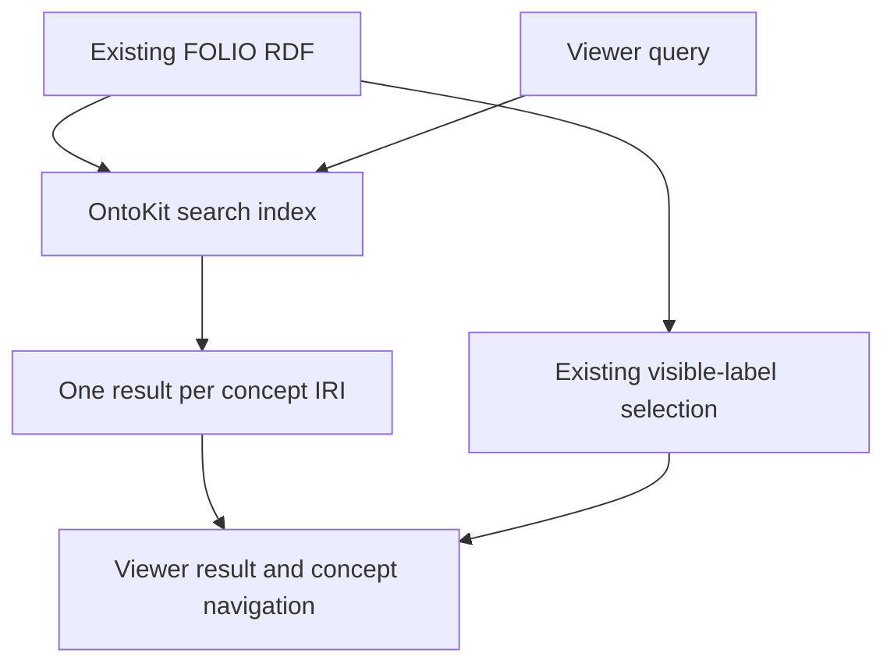

# Agreements hidden-label viewer search - Plan

## Goal Capsule

- **Objective:** FOLIO viewer users can find Agreements / Contracts by searching Accord, Accords, Pact, Pacts, Compact, or Compacts.
- **Means:** Make the existing hidden labels searchable in the owning OntoKit consumer, preserving visible names (KTD1, KTD2).
- **Authority:** The chief repository's `docs/plans/2026-10-26-0705-feat-codex-drawdown-campaign-plan.md`, Goal Capsule and campaign R11, R15, R16, R17, R19, R20; the supplied drawdown mandate; `AGENTS.md`; and the retained decisions from this plan's October 20 rebuild.
- **Execution boundary:** This is `foli-3` only, on `drawdown/foli-3`. The controller owns source provisioning, publication, and campaign review gates. This clone performs local commits only.
- **Stop conditions:** U2 and U3 cannot start until U1 binds the current consumer implementation and test paths. This FOLIO checkout contains no viewer or search index. Do not substitute a FOLIO-only search implementation or claim viewer completion from producer tests.
- **Remaining owner:** The controller must route the downstream work to the owning checkout within the campaign's one-item branch rules. No new Damien decision is needed to obtain source or verify existing behavior.

The chief plan is not available in this sandbox.
The campaign R-ID references above come from the supplied standing rules; their source text has not been independently read.
Controller verification of the named Goal Capsule and R-IDs remains a prerequisite, without reading the rest of the campaign plan.

---

## Product Contract

### Summary

Complete the downstream search residual of the October 20 Agreements label rebuild.
Preserve the RDF already shipped and add regression coverage at the actual consumer boundary.
This revision retains the rebuild's content decisions and narrows active work to the remaining `foli-3` outcome.

### Problem Frame

The six accepted hidden labels are present in both committed ontology artifacts, but the latest local consumer evidence is historical.
Section 4 of `docs/2026-08-05-staged-change-census.md` reports that OntoKit's `LABEL_PROPERTIES` excludes `skos:hiddenLabel`; the October 20 plan repeats that finding.
Neither document proves the current consumer still has the defect.
The current OntoKit source and tests are absent from this checkout.

### Re-verified starting state

Read-only inspection on 2026-10-26 used FOLIO commit `417a5e2ece96b011d4209986aa8a5a454c521cca`.
No tests, application builds, index refreshes, or provider calls ran during planning.

| Evidence | Finding | Consequence |
| --- | --- | --- |
| `FOLIO.owl`, `FOLIO-webprotege-merge-output.owl` | Both Agreements blocks contain the six accepted hidden labels. | No label addition or regeneration is needed for this item. |
| Agreements IRI `https://folio.openlegalstandard.org/R88D8i8AcSTUig2X3yPbFHg` | Visible labels remain Agreements / Contracts; Agreement and Contract remain alternative labels. | Preserve identity and displayed naming. |
| `scripts/generate_webprotege_merge.py` | New hidden labels use the existing insertion path; predicate moves and inline closing tags are handled. | The producer fix is already present. |
| `tests/test_webprotege_label_additions.py`, `tests/test_webprotege_literal_normalization.py`, `tests/test_webprotege_fidelity.py` | Existing tests cover propagation, predicate separation, literal normalization, and fidelity. | Retain these tests; their presence is not a fresh passing result. |
| Git object `bf78c7809c1aaaf8450fc1ad2dbde3cf64da071b` | Present locally but not an ancestor of inspected HEAD. | Ancestry remains unmerged; desired six-term content is already rebuilt. |
| Tracked source inventory | No OntoKit index, viewer, frontend manifest, or Playwright harness. | Consumer changes cannot be implemented in this clone. |

Current remote branch existence was not checked; the clone has no remote.
The old branch's reported 18-commit lag is historical, not a current comparison against `main`.

### Requirements

**Search behavior**

- R1. Each of the six accepted hidden-label queries retrieves the Agreements IRI through the real consumer index and viewer search.
- R2. Search results and concept navigation retain the consumer's existing visible-label selection; a hidden label must not become a display-name fallback.
- R3. Existing correct visible-label matches retain precedence when a newly searchable hidden form belongs to another concept.
- R4. Multiple matching labels on one concept produce one result for its IRI, using existing language and normalization behavior.

**Preservation and proof**

- R5. Preserve both ontology artifacts and existing tests; do not restore the stale branch's rejected terms or alter published IRIs.
- R6. Prove retrieval with both a fresh disposable index and an existing disposable index after the supported local refresh path.
- R7. Record actual consumer and viewer evidence before declaring the item complete; FOLIO-only or mocked-search evidence cannot satisfy R1.
- R8. Keep work within the supplied campaign constraints, including no credentials, spend, production data changes, remote setup, or unauthorized publication from this clone.

### Scope Boundaries

The active scope is the missing consumer behavior for existing labels.
It does not reopen the completed choice of six terms.
`Agreement` and `Contract` were excluded as hidden labels because they already occupy `skos:altLabel` on this class.
`Covenant(s)` and `Indenture(s)` were excluded to avoid competing concept ownership.
The October review also excluded `Concordat(s)` and `Undertaking(s)` because of their different meanings and recorded those content questions separately.
None of those content questions blocks searching the retained terms.

No new search engine, tokenizer, fuzzy matching, locale policy, UI redesign, ontology export, or duplicate fixture framework is planned.
The existing consumer must first show a concrete need before any such mechanism could enter scope.
Do not merge, cherry-pick, delete, or copy the ontology from `add-synonyms-appellate-appeal` merely to reconcile ancestry.

### Deferred to Follow-Up Work

Broader hidden-label coordination belongs to `foli-5`.
Provider qualification, canaries, README examples, general coverage, dependency audits, and release work belong to other mandate items.
Production index activation is outside this sandbox's mandate; local acceptance must not be described as a live rollout.

---

## Planning Contract

### Key Technical Decisions

- KTD1. **Fix the consumer, preserve the producer.** The required RDF and merge behavior already exist. R1 and R5 rule out adding a parallel FOLIO search module or converting hidden labels into alternative labels.
- KTD2. **Trace search and display uses before changing a property list.** The census names `ontokit-api/ontokit/services/ontology_index.py`, but that is a historical lead. A shared property list could affect display as well as retrieval. Apply the smallest consumer change satisfying R1 and R2 after U1 establishes the current path.
- KTD3. **Characterize the existing consumer before extending retrieval.** Preserve exact visible-label precedence, IRI deduplication, and locale handling through behavioral tests for R3 and R4. Do not invent ranking weights or storage changes from the census's one-line-fix suggestion.
- KTD4. **Use real local integration evidence.** The merge pipeline once reported changes it never applied; detection alone is insufficient. R6 and R7 require building and querying the real index, then exercising the actual viewer. See `docs/solutions/logic-errors/merge-pipeline-reported-changes-it-never-applied.md`.
- KTD5. **Keep publication with the campaign controller.** Local-only commits preserve this lane's branch boundary under R8. The controller supplies the required reviews and merge gate; this plan adds no separate approval request.

SKOS supports hidden forms for retrieval without ordinary visible labeling. This informs KTD2. See [W3C SKOS Primer, hidden labels](https://www.w3.org/TR/skos-primer/#sechidden).
The [SKOS Reference, labeling properties](https://www.w3.org/TR/skos-reference/#labels) distinguishes language-tagged literals and makes the SKOS labeling properties subproperties of `rdfs:label`.
If OntoKit uses inferred labels, U1 must trace that path before asserting R2.
The standard does not choose a ranking algorithm for KTD3.

### Consumer flow to verify

### Blocking prerequisites

1. **Controller source provision and routing:** Supply the current OntoKit index/API and viewer checkout or source snapshot, with commit identity and repository instructions. Route code changes to the owning repository without adding a remote or seeking credentials in this clone.
2. **Consumer path binding:** U1 must replace the historical edit lead with verified current source, existing test paths, test commands, and local index-refresh behavior before U2 or U3 starts. These are planning gaps, not permission or taste questions.
3. **Campaign authority verification:** Supply or verify the chief plan's Goal Capsule and the cited campaign R-IDs. The supplied user rules govern the current planning artifact.
4. **Cockpit attribution:** The controller must run the real scanner and confirm the new top-level state/actions belong to repository ID `folio`. No scanner entrypoint or configuration was established in this sandbox; filename conformance alone is not scanner evidence.

### Assumptions and risks

The historical exclusion of hidden labels may already be fixed in current OntoKit.
U1 resolves that uncertainty before proposing a code patch.
A property-level change may activate hidden labels throughout FOLIO, so R3 includes a cross-concept collision regression rather than only six happy-path queries.

U2 assumes the current index can retain search/display separation without a schema migration or data rewrite.
If that proves false, record the exact prerequisite and a held-change explanation under the campaign rules; do not quietly expand this item's scope or claim completion.
No migration, package release, new outside service, or deployment configuration change is currently proposed.

---

## Implementation Units

### U1. Establish the current consumer boundary

**Goal:** Determine whether the reported defect still exists and bind the actual implementation and test locations.

**Requirements:** R1-R8; KTD1, KTD2, KTD5.

**Dependencies:** Controller source provision/routing and campaign authority verification.

**Files:** This plan; `STATUS-HIDDEN-LABEL-SEARCH.md`; `NEXT-HIDDEN-LABEL-SEARCH.md`; the consumer's verified source and test files once available. The historical lead is `ontokit/services/ontology_index.py` relative to the `ontokit-api` repository, not a file in FOLIO.

**Approach:**

1. Record the controller's routing receipt identifying the owning repository, checkout revision, and item branch. This FOLIO branch delivers planning and continuity artifacts; it cannot carry the consumer patch.
2. Read the owning repository's instructions and inspect its current search entrypoint, index builder, result serialization, and visible-label selection.
3. Trace every use of the label-property collection, including inference if present, and identify the supported disposable local index lifecycle.
4. Bind exact code/test paths and commands in U2/U3. Record current commit identity and whether the original defect persists.
5. If behavior is already implemented, require its current acceptance evidence and add only genuinely missing regression coverage; do not create a redundant fix.

**Test expectation:** No new behavior in this unit. The build stage establishes existing consumer and FOLIO baselines after source binding.

**Verification:** U2/U3 have concrete, inspected file paths and a reproducible local test setup. If source remains unavailable, preserve the blocker and stop dependent work.

### U2. Enable hidden-label retrieval without changing displayed names

**Goal:** Satisfy the search contract through the current consumer implementation.

**Requirements:** R1-R5; KTD1-KTD3.

**Dependencies:** U1. This unit is blocked in the supplied FOLIO-only clone.

**Files:** Verified index builder, search query path, and index/API regression tests from U1. Exact downstream test paths are unresolved and must be added here before implementation; no guessed path is an authorized edit target.

**Approach:** Extend the existing retrieval path with hidden-label values while keeping the established display-name source separate where needed. Use the existing normalization, language filtering, and IRI identity rules. Retain current public response shapes and storage contracts.

**Execution note:** Start with failing behavioral tests against the real index and characterize affected visible-label behavior before changing it.

**Test scenarios:**

1. Each of Accord, Accords, Pact, Pacts, Compact, and Compacts retrieves the Agreements IRI with its established visible label.
2. Agreement and Contract retain their existing correct result after hidden-label indexing is enabled.
3. A synthetic concept whose hidden form equals another concept's exact visible label does not displace the existing correct visible-label match.
4. Multiple matching label predicates on one subject yield one concept result.
5. Untagged hidden `Accords` and alternative `Accords` tagged `fr-fr` retain the consumer's current locale behavior; they are not the same RDF literal.
6. A concept with only a hidden label retains the existing non-hidden display fallback. Include inferred-label handling only if the real consumer uses inference.
7. Existing case/whitespace and no-match behavior remains unchanged in the affected query path.

**Patterns to follow:** The owning consumer's index/API tests, identified by U1. The FOLIO tests cited in the starting-state table remain producer regression coverage, not replacements for consumer tests.

**Verification:** Actual index/query assertions pass together with existing consumer tests. Both FOLIO ontology artifacts remain unchanged under R5.

### U3. Verify refresh and real viewer behavior

**Goal:** Establish the user-visible outcome and record its evidence boundary.

**Requirements:** R1, R2, R4, R6-R8; KTD4, KTD5.

**Dependencies:** U2, or U1 evidence that the fix already exists with equivalent regression coverage.

**Files:** Existing index lifecycle integration tests and viewer Playwright spec identified by U1; `docs/plans/evidence/foli-3-hidden-label-search.png` as a planned evidence artifact in FOLIO; `STATUS-HIDDEN-LABEL-SEARCH.md`; `NEXT-HIDDEN-LABEL-SEARCH.md`. Exact consumer test paths must be bound before this unit starts.

**Approach:** Exercise the supported refresh of disposable local state and drive the real viewer against the tested consumer. Record source commits, ontology identity, commands, and outcomes in the focused status receipt. Do not use mocked search responses or a fabricated page as acceptance evidence.

**Test scenarios:**

1. A fresh disposable import satisfies R1 and R2 through the viewer's search interaction.
2. A disposable index representing pre-fix state lacks hidden-label postings and fails the hidden-term query before refresh. The supported refresh makes that query return the expected IRI; importing with new code before the initial assertion would not prove this transition.
3. Selecting a hidden-term search result opens the Agreements IRI and preserves the displayed canonical name.
4. Repeating searches and refresh does not introduce duplicate concept results.

**Verification:** Consumer integration and browser assertions pass. Commit a Playwright screenshot of the changed page under `docs/plans/evidence/` for any frontend change and report its path as `SCREENSHOT: <path>`. Capture the actual viewer for this acceptance receipt even when the fix is backend-only; a screenshot supports, but does not replace, assertions. Record local verification separately from any later live activation.

---

## Verification Contract

These are build-stage checks, not planning-stage test results.
The exact downstream commands remain blocked on U1.

| Check | Evidence required |
| --- | --- |
| Fresh FOLIO baseline and final regression suite | `.github/workflows/tests.yml` uses Python 3.12 and `python -m pytest tests -q`; report the actual results without reusing historical counts. |
| Existing merge regressions | Preserve `tests/test_webprotege_label_additions.py`, `tests/test_webprotege_literal_normalization.py`, and `tests/test_webprotege_fidelity.py`. |
| Producer preservation | Byte-identical `FOLIO.owl` and `FOLIO-webprotege-merge-output.owl` relative to the build-stage starting commit. |
| Consumer tests | Exact U1-bound test paths and commands; real index/query results covering U2. |
| Index refresh and viewer | U3 integration assertions, current source identities, and real Playwright evidence. |
| Documentation handoff | Focused status receipt, only genuine open actions in NEXT, and actual Cockpit attribution to `folio`. |

---

## Definition of Done

`foli-3` is complete only when R1-R8 have evidence from the owning consumer and viewer, with current suites passing and existing tests preserved.
U1's source mapping, U2's query regressions, and U3's local refresh/browser proof are all required.
The controller records publication and required reviews under the campaign gate.
No experimental search implementation, abandoned fixture framework, or unrelated cleanup remains in the diff.

The planning stage finishes with this committed artifact and focused continuity files.
It does not complete the viewer feature, establish a live rollout, resolve stale remote-branch ownership, or verify unavailable scanner output.

---

## Retained Rebuild Context

The October 20 rebuild started from current `main` instead of merging the stale sixteen-term proposal.
It selected the six clean terms with an intended ground-triple change of +6/-0 and a case-insensitive cross-concept collision check.
Fork PR #1 merged the rebuilt labels and producer fix; `STATUS-ONTOLOGY-QA.md` records that historical result.

During regeneration, new hidden labels on existing classes were detected as missing from the output path.
The fix added hidden-label detection and insertion alongside alternative labels, retained indentation, and handled inline closing tags.
Moves between alternative and hidden predicates remove the prior slot; moves to visible naming predicates and same-predicate language retagging retain the appropriate removal suppression.
Those behaviors are already represented in `tests/test_webprotege_label_additions.py`.

The old plan reported the stale branch still present remotely; this planning run checked only the local commit's ancestry.
Branch deletion remains outside this item.
The former downstream-search open item is the active scope of U1-U3.
