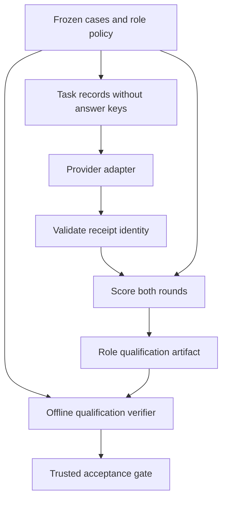
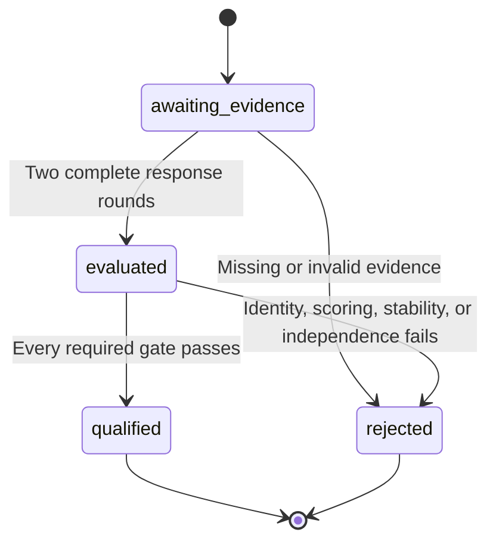

# Release B Independent Provider Qualification - Plan

## Goal Capsule

- **Objective:** Give FOLIO maintainers trustworthy evidence of whether independent model providers qualify for Release B.
- **Means:** Repair the existing qualification evaluator, provider identity checks, and evidence replay, then retain a separate live qualification gate (KTD1-KTD4).
- **Authority:** This is the `foli-2` planned item on `drawdown/foli-2`, scoped to the origin plan's U3/U4/U11 and their existing evidence consumers. The campaign authority is the chief repository's `docs/plans/2026-10-26-0705-feat-codex-drawdown-campaign-plan.md`, Goal Capsule and R11/R15/R16/R17/R19/R20. Campaign rules supplied with this lane govern until the controller can reconcile the unavailable chief source. Repository `AGENTS.md` and the origin Product Contract remain applicable.
- **Execution profile:** This stage writes and commits a plan only. The build stage can complete the offline units without provider access; the live qualification gate remains blocked under R7.
- **Stop conditions:** Fail closed on invalid qualification evidence, absent or mismatched served identity, failed thresholds, unsupported coverage, or exhausted limits. Stop before spend, credential access, security changes, production-data changes, or remote publication from this clone.
- **Tail ownership:** The build lane commits local changes; the controller scans, pushes, and opens the PR, and the campaign merge gate owns merging. An authorized operator owns the later provider-backed run and its receipt.

---

## Product Contract

### Summary

Complete the locally actionable qualification work and make the remaining live gate explicit.
Use the existing six-role evaluator, OpenAI/Google adapters, immutable evidence, and tests.
Offline success establishes implementation correctness; Release B qualification requires genuine provider evidence.

### Problem Frame

The repository already implements route qualification, but its current evaluator can overstate what it proved.
Correction requests expose the expected repair, proposer repeat stability ignores replacement text, defect recall counts abstentions as detections, and Google's transport supplies the requested model when the served identity is absent.
Correction-lineage replay checks artifact hashes and bindings without recomputing correction-role qualification performance.
These source-derived gaps would weaken the meaning of a later live qualification run.

### Reverified Starting State

Static inspection began at clean commit `417a5e2ece96b011d4209986aa8a5a454c521cca` on `drawdown/foli-2`; no remotes are configured.
No tests or provider calls were run during planning.
The historical `191 passed` receipt is not a fresh baseline.

| Evidence | Current finding |
| --- | --- |
| `scripts/run_trusted_ontology_qa.py`, `_qualify` and the six-role loop | Qualification machinery exists; all roles must qualify before the trusted run advances. |
| `scripts/ontology_qa/qualification.py` | Provider independence, proposer exclusion, input binding, expiry, and content hashes already have implementations. |
| `scripts/ontology_qa/evals.py`, `evaluate_predictions` | Recall uses the complement of false acceptance, incorrectly crediting abstention, missing predictions, and invalid repairs. |
| `scripts/ontology_qa/providers/google.py`, `_gemini_transport` | Missing `modelVersion` falls back to the requested model. |
| `scripts/ontology_qa/replay.py` and `scripts/ontology_qa/correction_evidence.py` | Production eval rounds are recomputed; correction qualification metrics are not. |
| `qa/ontology/model-policy.yaml` | Six roles use three pinned routes: `openai:gpt-5.6-sol`, `google:gemini-3.5-flash`, and `openai:gpt-5.6-terra`. These are configuration, not verified availability. |
| `qa/ontology/evals/slice-controls.json` | Three neutral controls expand across 27 required slices; two defect controls per slice satisfy the proposer's two-case minimum mechanically. |
| `docs/handoffs/2026-10-20-release-a-canary-and-qa-residuals.md` | The keyless canary completed on October 20; the trusted job ran zero steps. Full Release A canary and genuine Release B qualification remain distinct open gates. |

### Requirements

IDs below are local to this plan; `origin Rn` refers to the July ontology QA plan, and `campaign Rn` refers to the chief plan.
Product Contract preservation: the origin contract is unchanged; this plan scopes its unfinished qualification work without replacing other units.

**Valid qualification evidence**

- R1. Correction qualification requests must contain only legitimate task inputs; evaluator-only expected answers remain private to the scorer. Traces to origin R9/R10/R13 and U3/U11.
- R2. Both qualification rounds must have exact case coverage and meet the unchanged global and slice thresholds. Proposer stability includes the exact replacement as well as the verdict; other roles compare verdicts. Traces to origin R11-R13 and U11.
- R3. Defect recall must count actual defect detections, while false acceptance remains a separate measure. Abstentions, omissions, and invalid repairs must not count as successful detections. Traces to origin R12/R13/R19.
- R4. Successful qualification must derive provider and served-model identity from validated receipts for every batch, including cache hits. Missing, blank, mismatched, or mixed identities block qualification without fallback. Traces to origin R11/R12 and U4/U11.
- R5. Trusted acceptance and snapshot-backed replay must apply the same role-specific qualification rules to the same frozen inputs. Self-consistent hashes alone cannot establish that those rules passed. Traces to origin R3/R17/R20a and U11.

**Delivery and evidence boundaries**

- R6. Add offline regression coverage without deleting, skipping, or weakening existing tests; preserve current roles, thresholds, limits, and ontology bytes. Traces to origin R24/R25 and campaign R15/R16.
- R7. Release B remains unqualified until an authorized live run supplies valid evidence for all six roles from genuinely available independent providers. This lane may not obtain credentials, spend, approve deployments, or substitute models. Traces to origin R8/R11-R13/R19/R25 and campaign R11/R20.
- R8. Continuity must distinguish the completed keyless canary, locally verified qualification code, and outstanding live qualification. Top-level STATUS/NEXT files retain genuine open actions and repository attribution to `folio`. Traces to `AGENTS.md` and campaign R17/R19/R20.

### Scope Boundaries

Active work is limited to qualification correctness, its existing replay consumers, regression tests, and the operator-facing qualification handoff.
No ontology data, eval-corpus rewrite, schema migration, package release, new outside service, frontend, deployment configuration, or security-setting change is required.

### Deferred to Follow-Up Work

- `foli-1` owns the full Release A Actions canary, correction-to-fresh-SHA handoff, and attestation proof.
- `foli-4` owns a general offline canary/readiness reporter; this plan adds no reporting CLI or workflow mode.
- Broader source-grounded legal-language benchmarks remain an origin U3 prerequisite for broader capability claims. Numeric controls cannot establish legal-language competence, and this item will not manufacture authority or relabel model consensus as gold.

Other mandate items, broad provider refactors, early configuration preflight, duplicate-role helper hardening, and rejected-run diagnostic retention are not built here.
The current runner constructs all six roles itself; these additions are not needed to close the demonstrated gaps.
Reconsider them only if build-stage evidence shows they prevent this qualification path from satisfying R1-R5.

---

## Planning Contract

### Key Technical Decisions

- KTD1. **Keep expected answers in evaluator-owned cases.** Derive provider records separately, preserving legitimate source, candidate, and confirmed-defect context. Centralize role-specific case construction and scoring in `scripts/ontology_qa/evals.py` so the runner and replay cannot diverge. Implements R1-R3/R5.
- KTD2. **Use one exact scoring rule for both rounds.** Compute recall as true defect predictions divided by defective scored cases. Invalid proposer replacements become failed task predictions. Require unchanged thresholds for each round; compare exact proposer replacements without normalizing them away. Keep current top-level metrics and immutable raw rounds; any additional round diagnostics fit the existing open `metrics` object. Implements R2/R3/R5 without a schema migration.
- KTD3. **Validate identity before caching or qualification.** Remove Google's request-derived identity fallback and apply the existing cached-receipt identity rule to fresh receipts. Derive a successful qualification's identity from those checked receipts. Retain each round's ordered batch request identities and normalized receipts in the existing open `metrics` object, including response bindings and cache provenance. The existing `ProviderReceipt` and `request_identity` supply these structures; no alias map or replacement provider is introduced. Implements R4.
- KTD4. **Add semantic qualification verification at trusted acceptance boundaries.** Preserve low-level correction byte replay, and invoke shared qualification verification from the trusted runner and the snapshot-backed bundle replay path. Reconstruct correction eval cases and blind batch request identities from retained controls, policy, prompts, and schemas, not from mutable checkout files. Match each receipt to its expected request, observed route, and stored responses before scoring. Missing bindings reject under current trusted verification even when old responses are all correct; old evidence is never rewritten to appear newly qualified. Hashes establish consistency within the existing trusted-run provenance, not independent proof of provider authorship. Implements R1/R4-R6.
- KTD5. **Separate the offline delivery from the live gate.** Complete authorized work without waiting for operator availability (session-settled: user-directed — chosen over waiting for operator input through 2026-10-30: the campaign requires progress without that dependency). Implements R7/R8; an offline merge does not certify Release B.

### High-Level Technical Design

The provider sees task records; only the evaluator sees the answer key.

Qualification evidence advances only through the existing gates.

### Assumptions and Dependencies

The build starts by establishing the actual offline test baseline; source inspection does not predict a passing test count.
The existing dependency ranges and Python 3.12 CI remain the baseline.
Current model pins and the policy's monetary cap are neither service-availability evidence nor authorization to spend.
The handoff's newer-model and cost suggestions are unadopted proposals.

The chief checkout, its campaign Goal Capsule, and Cockpit scanner were unavailable in this sandbox.
The controller must verify the cited campaign requirements and scanner attribution before the build handoff is treated as fully reconciled.
This is controller work, not a new request for the user to supply credentials or local files.

U1 and U2 can be developed independently; U3 follows both; U4 records the verified result and the external gate.
No competing architecture needs a bake-off: the existing evaluator, receipt, and replay boundaries already define the integration points.

---

## Implementation Units

### U1. Make correction qualification blind and scoring accurate

**Goal:** Ensure passing qualification measures the requested task in both rounds.

**Requirements:** R1-R3/R6; origin U3/U11.

**Dependencies:** Build-stage baseline verification.

**Files:** Modify `scripts/ontology_qa/evals.py`, `scripts/ontology_qa/qualification.py`, and `scripts/run_trusted_ontology_qa.py`; extend `tests/test_model_evals.py` and `tests/test_model_qualification.py`.

**Approach:**

1. Extract the current role-specific case derivation and response scoring into shared pure evaluator logic under KTD1/KTD2.
2. Remove evaluator-only answer fields from proposer and verifier records. Keep the current schemas and legitimate task context.
3. Make both rounds participate in qualification, with exact coverage, task-specific stability, and corrected global/slice recall.
4. Repair the existing proposer test's oracle: hold expected responses in test-owned fixture data rather than reading an answer key from the request. Preserve its qualified-result, prompt-hash, and schema-hash assertions.

**Execution note:** Add focused failing regressions before changing the evaluator.

**Patterns:** Existing `evaluate_predictions`, frozen authority tiers, `create_qualification`, and injectable `_qualify` adapter tests.

**Test scenarios:**

1. Capture proposer and verifier requests: expected verdict/replacement fields are absent, legitimate source/candidate/defect context remains, and correct responses still qualify.
2. Correct first repair and incorrect second repair with identical verdicts rejects; reversing the rounds also rejects. Two correct stable repairs qualify; two identical wrong repairs reject.
3. Verifier verdicts that change between rounds reject; harmless rationale wording changes do not change stability.
4. For defective cases, `abstain`, missing prediction, `pass`, and invalid replacement each contribute zero true detections. Only `pass` contributes to false acceptance; missing predictions remain incomplete.
5. A mixed corpus can meet 0.90 accuracy while falling below 0.95 defect recall; reject it globally and in an affected slice. Preserve the 0.02 maximum false-accept rate.
6. Omitted, duplicate, or extra case IDs in either round reject. Preserve unscored-challenge exclusion, unsupported slices, and the existing control-expansion assertions.

**Verification:** Complete fixtures pass all unchanged thresholds; each counterexample fails for the intended reason, with no provider access.

### U2. Bind qualification to observed provider identity

**Goal:** Prevent requested identity from substituting for missing or conflicting served identity.

**Requirements:** R4/R6; origin U4/U11.

**Dependencies:** Build-stage baseline verification; independent of U1.

**Files:** Modify `scripts/ontology_qa/providers/google.py`, `scripts/ontology_qa/execution.py`, and the qualification call boundary in `scripts/run_trusted_ontology_qa.py`; extend `tests/test_model_review.py`, `tests/test_review_execution.py`, and `tests/test_model_qualification.py`.

**Approach:**

1. Apply KTD3 at the actual Google HTTP-response parser, not only at its injected adapter seam.
2. Check fresh receipts before cache publication using the same provider/requested/actual-model contract as cache hits.
3. Carry checked identity and per-batch request/receipt evidence into qualification construction under KTD3. Reject a receipt whose request identity differs from the dispatched batch; on failure, preserve the existing rejected-run path without inventing a served identity.

**Patterns:** OpenAI's strict model check, `ProviderReceipt`, `ImmutableReviewCache`, and existing mocked `urlopen` tests.

**Test scenarios:**

1. Mocked raw Google responses missing `modelVersion`, or supplying null, empty, whitespace-only, or mismatched values, fail without fallback; an exact pinned identity succeeds.
2. A fake fresh adapter returns the wrong provider, requested model, or actual model: the executor rejects it before cache publication.
3. A later batch or repeat round changes identity: no role qualification succeeds and no acceptance artifact is produced.
4. Cached receipt mismatches remain rejected; a valid cached receipt retains its observed identity but does not count as proof of present service availability.
5. Existing OpenAI mismatch handling, structured-output parsing, bounded retries, and budget-reservation tests remain effective.
6. A receipt for a different request is rejected before cache publication. A valid qualification retains the exact round/batch request identities, observed routes, responses, and cache provenance for offline verification.

**Verification:** Identity tests cross the raw-transport and executor boundaries, and successful qualification fields agree with the checked receipts.

### U3. Recompute qualification semantics during trusted replay

**Goal:** Make the durable evidence consumer enforce the same qualification result as the producer.

**Requirements:** R2-R6; origin R20a/U11.

**Dependencies:** U1, U2.

**Files:** Modify `scripts/ontology_qa/replay.py`, `scripts/ontology_qa/correction_evidence.py`, and the relevant trusted-runner calls in `scripts/run_trusted_ontology_qa.py`; reuse the U1 evaluator; extend `tests/test_evidence_replay.py`, `tests/test_correction_evidence.py`, and `tests/test_trusted_changed_record_corrections.py`.

**Approach:**

1. Use KTD4 to verify production, benchmark, proposer, and verifier qualifications wherever they contribute to a trusted decision. Apply role-specific prompt/schema/corpus bindings and existing provider-independence rules.
2. Reconstruct blind batches and request identities under KTD4, validate their retained receipt bindings, then recompute both rounds and compare claimed metrics, stability, qualified slices, and status. Never use an artifact's self-reported metrics as their own oracle.
3. Require the complete qualification input set at the trusted acceptance boundary. Keep low-level byte-lineage replay available for its existing purpose; it cannot substitute for full qualification verification.
4. Preserve historical artifacts and their provenance. A bundle that fails corrected semantics remains invalid under current verification; changing hashes or the current date cannot promote it.

**Patterns:** Snapshot-backed production evaluation in `replay_bundle`, canonical qualification hashing, and correction source/ledger byte replay.

**Test scenarios:**

1. A complete synthetic six-role bundle passes online scoring and offline verification with the same decisions, hashes, and metric values, without network access.
2. Change a second-round proposer repair, recompute enclosing hashes, and falsely retain a qualified status: replay rejects the semantic mismatch.
3. Repeat that attack with abstention credited as recall, a missing response, or a substituted role/corpus/policy binding: verification rejects each.
4. Omit required frozen inputs from a trusted bundle: acceptance fails rather than falling back to checkout files or low-level replay.
5. Preserve correction reapplication, proposer exclusion, cross-provider checks, missing-stage and tamper tests. Existing minimal byte-replay fixtures remain tests of byte replay, not newly claimed qualification evidence.
6. An expired-now artifact may still support historical replay at its recorded run time; it cannot authorize a new run. Preserve the existing current-qualification expiry checks.
7. A legacy all-correct, stable artifact lacks request bindings or binds requests that contain expected answers: current trusted qualification verification rejects it even though response-only rescoring would pass. Preserve low-level historical byte replay without promoting that evidence to Release B qualification.

**Verification:** Full trusted bundles cannot claim qualification that the shared scorer rejects, even after all self-computed hashes are updated.

### U4. Document the live qualification gate and deliver the local result

**Goal:** Leave an operator enough evidence to distinguish completed local fixes from the remaining Release B qualification work.

**Requirements:** R7/R8; campaign R11/R17/R19/R20.

**Dependencies:** U1-U3 and their offline verification.

**Files:** Update the automated QA section of `README.md`, `STATUS-ONTOLOGY-QA.md`, and `NEXT-ONTOLOGY-QA.md`; create `docs/handoffs/2026-10-26-foli-2-provider-qualification.md` as the build-stage receipt.

**Approach:**

1. Record current commit identity, test outcomes, code changes, limitations, and the complete list of unrun live gates. Avoid copying historical suite counts as new evidence.
2. Document the live acceptance evidence below, including frozen model policy and all six roles. Leave credential values and private account details out of every artifact.
3. Keep only genuine open actions in NEXT, with controller-owned checks separate from user-owned prerequisites; verify scanner attribution to `folio` where available.

**Test expectation:** None for prose alone. Validate every claimed outcome against the build receipt and U1-U3 results.

**Verification:** The handoff explicitly says whether live qualification ran; absent genuine evidence, Release B remains blocked even if the code PR is ready.

---

## Verification Contract

The build stage follows `.github/workflows/tests.yml`: Python 3.12, `scripts/requirements.txt`, and the complete pytest suite under `tests/`.
Establish a fresh baseline before edits, run the affected suites while implementing, and finish with the full suite.
Preserve all existing tests and assertions; fixture changes must retain or strengthen their coverage.

| Gate | Scope | Required outcome |
| --- | --- | --- |
| Blind task inputs and repeat scoring | U1 | Captured requests contain no answer key; both rounds enforce exact repair and unchanged thresholds. |
| Recall and completeness | U1 | Abstentions, omissions, and invalid repairs receive no detection credit; exact case sets remain mandatory. |
| Actual identity | U2 | Raw transport, fresh receipts, cached receipts, and qualifications agree on the pinned route. |
| Semantic replay | U3 | Reconstructed blind requests match retained receipts; recomputed metrics agree and rehashed false claims fail. |
| Existing safety contracts | U1-U3 | Full offline suite passes, including correction, reconciliation, execution budgets, workflow contracts, and attestation tests. |
| Diff and scope | All | Whitespace/diff checks pass; no ontology, corpus, schema, dependency, frontend, or deployment change enters this item. |
| Continuity | U4 | STATUS/NEXT contain current evidence; scanner attribution is verified or explicitly left to the controller. |
| Live Release B qualification | External gate | Genuine, role-specific provider evidence meets R7 and the acceptance requirements below. |

### Live Acceptance Evidence

This is an external acceptance gate, not an instruction for this clone to execute provider calls.
The future authorized operator must retain:

- The immutable commit, frozen policy/prompts/schemas/corpus identities, execution time, and trusted-run provenance.
- Valid qualification artifacts for production-primary, production-independent, benchmark-adjudicator, correction-proposer, correction-verifier-1, and correction-verifier-2, including both rounds and observed provider identities.
- Evidence that the current provider routes were actually exercised; fixture responses and cache-only runs cannot establish availability.
- All unchanged per-slice thresholds, exact case coverage, stability, role separation, budgets, and the offline replay outcome.
- A statement of corpus limits. Neutral numeric controls demonstrate number preservation, not broad legal-language competence; unsupported or unsubstantiated capability claims remain blocked.

No full-canary attestation is claimed here: that is `foli-1`'s separate evidence obligation.

---

## Risks and External Blockers

The live gate needs authorized OpenAI and Google access, available pinned models, a bounded approved spend, and the existing trusted execution approval.
The policy's `maximum_cost_usd` is a ceiling, not spending permission; historical cost estimates are not current pricing evidence.
If a pinned model is unavailable, report that fact for separately scoped requalification rather than silently substituting one.

The existing neutral controls satisfy mechanical slice counts but do not resolve the origin plan's broader legal-language evidence requirement.
A live numerical-control pass must therefore be reported with that limitation; it cannot by itself close the entire Release B capability claim.
Source-grounded corpus work and external availability remain explicit residuals, not reasons to delay the local correctness fixes.

**Needs your decision, after the unavailable period:** Authorize the already-prepared provider-backed run and bounded spend once exact routes and costs are known. Setting: browser with logins plus a 5-minute decision. Estimated operator time: 10-15 minutes, excluding provider execution. Unblocks genuine route qualification evidence. Credential setup and deployment approval remain outside this lane.

The chief-source check and Cockpit scanner run are controller-owned prerequisites, not user decisions.
No held schema migration, data rewrite, package release, or outside-service addition is proposed.

---

## Definition of Done

- U1-U4 are implemented and verified in the build stage, with new regressions and every existing test preserved.
- The local result changes only the scoped qualification code, tests, and documentation; abandoned experimental changes do not enter the final diff.
- A durable handoff distinguishes local verification from the blocked live gate and states the language-evidence limitation.
- Controller authority/scanner checks and campaign review prerequisites are recorded truthfully; local delivery does not bypass the controller's push/PR/merge ownership.
- The `foli-2` item remains open for live qualification until R7 and the origin U3/U11 evidence obligations are satisfied. Offline implementation completion is a separate milestone.

---

## Sources and Research

- `docs/plans/2026-07-30-001-feat-automated-ontology-qa-plan.md`: Goal Capsule, R8-R13/R15a/R19/R20a/R24/R25, U3/U4/U11, and Verification Contract.
- `docs/handoffs/2026-10-20-release-a-canary-and-qa-residuals.md` and `docs/residual-review-findings/automated-ontology-qa.md`: separate live prerequisites and Release A residuals.
- `docs/solutions/integration-issues/keyless-canary-for-workflow-run-dispatch-chain.md`: the keyless canary's proof boundary.
- `docs/solutions/logic-errors/merge-pipeline-reported-changes-it-never-applied.md`: verify consumer outcomes rather than infer success from intended work.
- `docs/FOLIO-CHANGE-POLICY.md`: preserve ontology identity and data; this item needs no ontology mutation.
- Current code, policy, and tests cited in the starting-state table and units supply the implementation evidence. No external research or live availability verification was performed.
