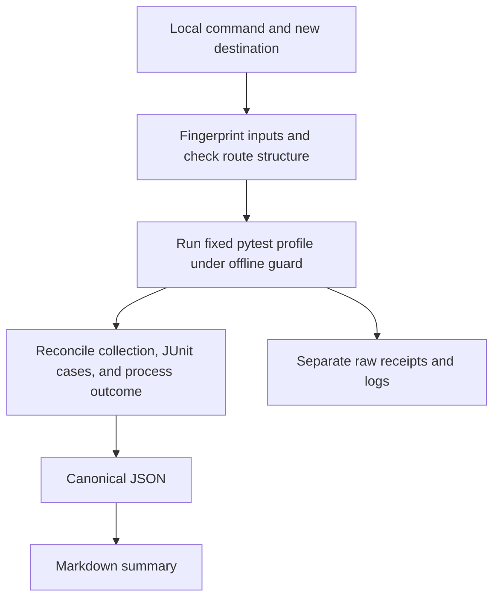
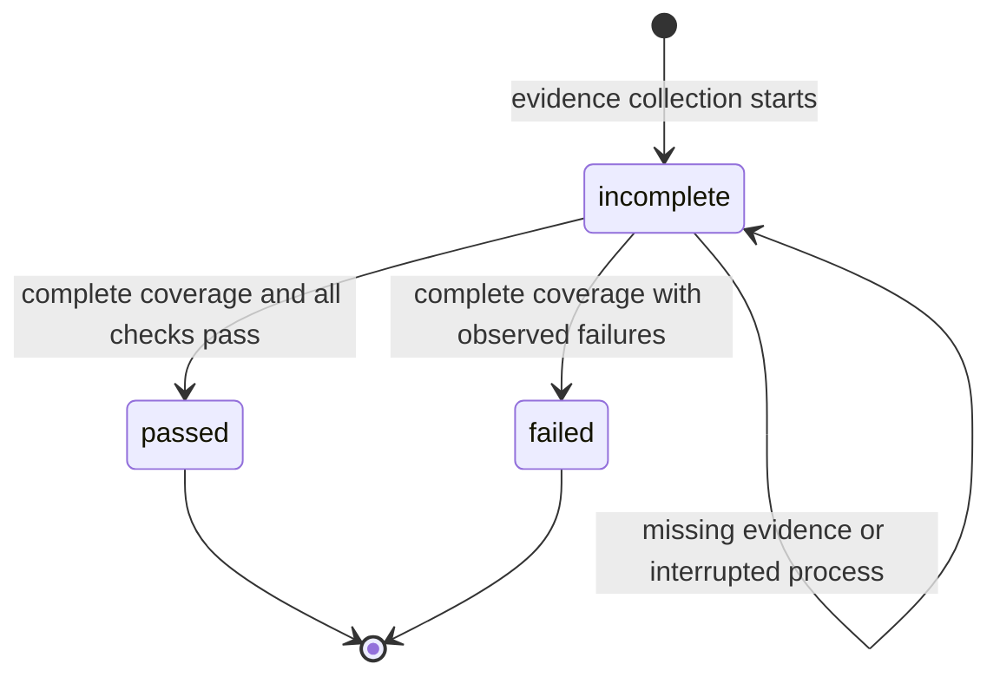

# Offline Ontology QA Readiness - Plan

## Goal Capsule

- **Objective:** Maintainers can reproduce the available offline QA evidence and identify what still needs a live canary before spending on provider-backed qualification.
- **Means:** A fixed offline test profile with deterministic readiness reports (KTD1–KTD4).
- **Authority:** The supplied drawdown mandate for `foli-4`, the campaign rules cited below, and `AGENTS.md` govern this expansion. Existing ontology-QA acceptance requirements remain authoritative.
- **Execution profile:** Establish the report and coverage contracts, implement the offline runner, then add operator documentation. Add tests without deleting or weakening existing tests.
- **Stop conditions:** Do not cross the campaign's spend, credential, publication, data-mutation, or security-setting boundaries. Treat missing offline evidence as incomplete.
- **Tail ownership:** This isolated branch carries local commits only. The controller scans, pushes, and opens the PR; the campaign gate owns reviews and merge. This stage produces the plan only.

### Authority and starting evidence

The campaign authority is the chief repository's `docs/plans/2026-10-26-0705-feat-codex-drawdown-campaign-plan.md`.
That repository and plan were not available in this isolated checkout, so its Goal Capsule and original requirement wording were not independently read.
This plan applies the supplied campaign constraints for R11, R15, R16, R17, R19, and R20; these are **campaign IDs**, distinct from this plan's local R-IDs.
The controller should reconcile the plan against that source when collecting the branch.

Static inspection on 2026-10-27 confirmed `417a5e2` on branch `drawdown/foli-4`, with no configured remote.
The worktree already contained this untracked draft plan and an empty, untracked `STATUS-FOLI-4.md`; it was not clean.
This stage resumes that draft and adds the required continuity records without changing application code.
The October 20 handoff and keyless-canary receipt record successful deterministic execution, trigger, and dispatch; the trusted job stopped at its environment gate before running any steps.
The full provider-backed canary remains open in those records.
The recorded 191-test result is historical; no tests or application scripts were run during this planning stage.

---

## Product Contract

### Summary

Add one local command that runs the repository's existing offline QA fixtures and writes a concise Markdown summary plus canonical JSON.
The report identifies tested behaviors, missing proof, and the remaining live qualification boundary.

### Problem Frame

Maintainers currently assemble readiness evidence from separate tests, replay commands, and dated status documents.
The first live keyless canary found three dispatch defects despite passing stubbed tests.
The replay CLI also exits successfully for a faithfully reconstructed blocked decision, so a successful command alone cannot establish release readiness.

### Requirements

**Offline evidence**

- R1. One documented local invocation shall run a fixed, versioned profile covering deterministic validation/delta, qualification rules, release-report decisions, evidence replay, full-policy trusted-runner fixtures, and workflow contracts.
- R2. The invocation shall require no network, provider credentials, GitHub login, remote, or package installation; live provider adapters shall not execute.
- R3. A passed result shall require complete evidence that all selected tests ran successfully, including the profile's mandatory proof cases.
- R4. Failed assertions shall produce `failed`; missing or untrustworthy execution evidence shall produce `incomplete`, taking precedence when both occur.

**Report meaning**

- R5. Reports shall identify their scope as offline test evidence and explicitly leave live provider qualification, live Actions configuration, and release authorization unevaluated.
- R6. Reports shall describe fixture behaviors proved by tests without claiming current ontology quality, a current accepted release, or genuine provider independence.
- R7. Identical input bytes, profile, dependency/runtime identities, and test outcomes shall produce byte-identical canonical JSON and Markdown summaries across fresh output directories.
- R8. Reports shall identify observed test outcomes and relevant input fingerprints; raw timing, paths, tracebacks, and clock-dependent fixture artifacts shall remain outside the reproducible summary.

**Preservation and delivery**

- R9. Each invocation shall exclusively create a new output directory and preserve existing files, ontology bytes, policies, acceptance artifacts, and workflow behavior.
- R10. Add regression coverage for this feature and retain every existing test and assertion.
- R11. Keep the expansion on `drawdown/foli-4` with controller-owned publication under campaign R15/R17/R19.
- R12. Record implementation evidence and genuine remaining actions in top-level Cockpit documents attributed to repository `folio`.

### Key Decisions

- **Ship this expansion through the campaign gate.** Governs R10, R11. (session-settled: user-directed — chosen over holding expansions for individual review: preserve unattended progress with required guardrails.)
- **Complete the offline work without waiting on a live-provider decision.** Governs R1, R2, R5. (session-settled: user-directed — chosen over waiting for Damien through October 30: the offline item can finish independently.)

### Acceptance Examples

- AE1. Covers R1, R3, R5. All mandatory offline tests pass: the report says `passed`, while live qualification is `not_run` and release authorization is false.
- AE2. Covers R3, R4. The full-policy trusted-runner test is absent or skipped: the report is `incomplete`, even if pytest otherwise exits successfully.
- AE3. Covers R4, R6. A test correctly rejects tampered evidence or a quarantined release: that test passes; the report makes no claim that a real release passed.
- AE4. Covers R7, R8. Two runs use the same inputs and outcomes in different directories: summaries match exactly even when JUnit timing and fixture qualification timestamps differ.
- AE5. Covers R9. An output path already exists, including a symlink or partial prior run: refuse it before running tests and preserve its contents.

### Scope Boundaries

The feature is a developer-facing offline readiness report.
It changes no ontology content, model policy, acceptance schema, signed-attestation path, trusted workflow, deployment configuration, or external service.
No schema migration, package release, production-data operation, or frontend is required.

#### Deferred to Follow-Up Work

The live Actions canary and genuine independent-provider qualification remain `foli-1`/`foli-2` work.
Hidden-label search, general usage examples, and broad dependency/security hygiene remain other mandate items.

#### Considered and not built

- A second fixture-to-bundle engine would duplicate the existing full-policy stub test; reconsider only if a consumer needs portable synthetic bundles.
- An arbitrary external-bundle reader would broaden the CLI beyond this fixed canary; the existing replay CLI already serves that use.
- A new CI job or required check would duplicate the current full-suite workflow; `.github/workflows/tests.yml` already discovers added tests.
- A network sandbox for hostile code is outside this item; the offline guard detects accidental calls in trusted repository tests.

---

## Planning Contract

### Assumptions

- The intended readiness question is whether the checked-out QA implementation passes its offline proof cases. It is not a census of the current `FOLIO.owl`; R5/R6 make that scope visible.
- Markdown and JSON are the useful human and automation outputs for this command; no UI is needed.
- Existing development dependencies are available before invocation. A missing dependency is an incomplete result, with installation instructions in the runbook.
- Current test behavior must be reverified during implementation. Historical counts do not establish today's passing baseline.

### Key Technical Decisions

- KTD1. **Reuse pytest as the canary engine.** Launch the existing selected tests in a subprocess instead of importing test helpers or adding an offline mode to the live trusted runner. The full-policy fixture already exercises real orchestration with controlled provider responses. This is a small reversible integration choice, so competing prototype implementations are unnecessary.
- KTD2. **Use an explicit coverage manifest and structured receipts.** Select whole test files, require named proof cases, and record the observed inventory. Derive outcomes from JUnit test cases plus collection evidence, never console text or pytest's exit code alone. Do not hardcode the total test count.
- KTD3. **Separate observation from authority.** Use a new report version, `folio-offline-readiness/v1`, with `evidence_scope: offline_test_suite`, `offline_status`, `live_qualification: not_run`, `live_actions: not_verified`, and `release_authorization: false`. Do not add a `release_decision` field or reuse the production report envelope.
- KTD4. **Fingerprint inputs and normalize observations.** Follow `records.py` canonical JSON/hash conventions. Bind the report to actual source/config/test bytes and Python/dependency identities; sort groups and test identities. Keep raw receipts and logs in a separate subdirectory and exclude their hashes from the stable report.
- KTD5. **Guard the test process before collection.** Use a dedicated, opt-in test plugin to reject network access and real provider construction. Launch pytest with the current interpreter, repository-root cwd, fixed selection, disabled third-party plugin autoload, and an allowlisted environment that does not inspect or inherit credentials or pytest selection overrides.
- KTD6. **Preserve output and expose incomplete execution.** Exclusively reserve the destination, use atomic file publication, retain partial evidence, and never clean up a prior run automatically. An interrupted or timed-out child is terminated and reaped; use a fixed 600-second timeout for the initial profile.
- KTD7. **Preserve campaign execution choices.** R11 uses local Astra work and cloud-default Sol builds with the campaign's Astra/Fable review gates. (session-settled: user-directed — chosen over the Sol-first local ladder: preserve the campaign's selected execution policy.) Ontology provider routes are a separate product policy and remain unchanged.

### Coverage manifest

The new profile selects all tests in these existing files.
Every selected file must contribute executed cases, all mandatory cases must be present, and selected cases must have no skips or expected-failure markers.
The full observed collection must match executed terminal cases; duplicates, missing identities, malformed receipts, collection errors, or contradictory process outcomes produce `incomplete` under R4.
The reporter's own tests are excluded from this nested profile to prevent recursion.

| Group | Existing test files | Mandatory proof examples |
|---|---|---|
| Deterministic fixtures | `tests/test_annotation_validators.py`, `tests/test_hydration_delta.py` | `test_baseline_debt_is_reported_but_only_new_failures_block`; `test_manifest_is_byte_stable_and_self_hashed` |
| Qualification rules | `tests/test_model_qualification.py`, `tests/test_model_evals.py` | `test_production_votes_must_use_different_providers`; `test_expired_or_mismatched_qualification_blocks`; `test_frozen_controls_cover_every_policy_slice` |
| Release decisions | `tests/test_hydration_qa_pipeline.py` | `test_quarantine_or_incomplete_stage_blocks`; `test_stale_candidate_hash_blocks_and_marks_report_stale` |
| Replay and lineage | `tests/test_evidence_replay.py` | `test_tampered_evidence_fails_replay` including its parameterized cases; `test_fresh_sha_bundle_replays_correction_source_lineage` |
| Full-policy fixture | `tests/test_trusted_changed_record_corrections.py` | `test_trusted_runner_accepts_with_stubbed_independent_providers`; `test_failed_validation_publishes_no_correction_artifacts` |
| Workflow contracts | `tests/test_workflow_contract.py` | `test_pr_path_has_no_secret_bearing_model_step`; `test_trigger_never_combines_slurp_with_jq`; `test_trigger_dispatch_names_repository`; `test_webprotege_requires_signature_and_offline_replay` |

The policy-bound fixture is essential: minimal replay fixtures use a compatibility path that does not exercise all production snapshots.
The selected suite's existing Python child invokes only `scripts/run_ontology_hydration_qa.py` in replay mode.
The offline guard must cover that child boundary and reject unexpected child commands; it must never launch the trusted CLI directly.

### High-Level Technical Design

Exit codes are 0 for `passed`, 1 for `failed`, and 2 for `incomplete`, usage errors, or publication failures.
Report missing proof ahead of observed failures, while preserving both in the check details.
Publication failure never returns success; when no destination can be created, stderr explains the problem without claiming a saved report.

### Static policy observation

Check that all six configured roles have nonempty provider/model identities, then apply the existing `validate_role_separation` rules to route descriptors.
This checks configured structure only.
Do not create qualification artifacts, invent provider receipts, inspect key presence, or change route/model selections.
The existing policy loader does not validate role completeness, so that check belongs in the new reporter.

### Input identity

Fingerprint the profile, relevant Python scripts and test helpers, `scripts/requirements.txt`, `schemas/`, `qa/ontology/` policies/prompts/evals, and the workflow files read by the selected tests.
Use explicit repository-relative input sets rather than a whole-home or credential-file scan.
Record effective Python and relevant installed package versions without filesystem installation paths.
Compare the input fingerprint again after execution; a mid-run change makes the report incomplete.
R7 binds summaries to matching identities and outcomes, not to matching raw fixture bundles.

---

## Implementation Units

### U1. Define coverage, outcomes, and reproducible reports

**Goal:** Make report meaning and completeness independently testable.
**Requirements:** R1, R3–R8; AE1–AE4.
**Dependencies:** None.
**Files:** Create `scripts/ontology_qa/offline_canary.py` and `tests/test_offline_canary.py`.
**Approach:**

1. Define the fixed coverage manifest, required proof identities, and KTD2 outcome reconciliation.
2. Add static route-structure observation using existing qualification helpers without manufacturing qualification evidence.
3. Implement KTD3/KTD4 report normalization and the Markdown projection.

**Patterns:** `scripts/ontology_qa/records.py`; `scripts/ontology_qa/qualification.py`; existing release-report tests.
**Execution note:** Establish failing report-contract tests before adding subprocess orchestration.
**Test scenarios:**

- Covers AE1. Complete passing receipt and valid route structure produce the documented offline-only fields.
- Covers AE2. Empty collection, missing file/sentinel, duplicate identity, skipped/xfail case, or malformed receipt produces incomplete.
- Covers AE3. Correctly passing rejection tests remain passed without publishing a release decision.
- A complete assertion failure produces failed; the same failure with missing coverage produces incomplete and retains the failure.
- Missing role, empty model, overlapping production/benchmark route, or same-provider votes cannot pass the configuration observation.
- Covers AE4. Reordered receipts with changed timestamps, timings, traceback paths, and output directories yield identical normalized reports for identical outcomes.
- An input or effective dependency change changes the fingerprint.

**Verification:** Unit tests prove the report contract without running the whole nested profile.

### U2. Run the profile without provider access or destructive output

**Goal:** Deliver the local command and trustworthy process receipts.
**Requirements:** R1–R4, R7–R10; AE1, AE2, AE4, AE5.
**Dependencies:** U1.
**Files:** Create `scripts/run_offline_ontology_canary.py` and `tests/offline_canary_plugin.py`; extend `scripts/ontology_qa/offline_canary.py` and `tests/test_offline_canary.py`.
**Approach:**

1. Expose `--output-dir` as the required destination and run the fixed profile under KTD5.
2. Capture collection identities and JUnit outcomes, verify their agreement, and publish KTD3 reports under KTD6.
3. Isolate volatile operational receipts from stable summaries and preserve incomplete runs for diagnosis.
4. Keep the guard opt-in for this command; ordinary pytest invocations retain their existing behavior.

**Patterns:** Existing argparse entrypoints; append-only/atomic publication in `scripts/ontology_qa/reporting.py`; the full-policy stub test.
**Test scenarios:**

- Covers AE1. A real invocation executes every selected file and the full-policy sentinel without live calls.
- Deny a network attempt during test-module collection and during execution, and reject real provider construction before any credential lookup.
- Verify the existing replay subprocess remains offline; unexpected child commands fail before invocation.
- Ambient pytest options, plugin settings, provider variables, proxies, and GitHub run IDs cannot alter selection or leak into the child/report.
- Covers AE2. Nonzero collection/internal exits, success exit with incomplete receipt, missing dependency, timeout, and interrupted execution return incomplete.
- Covers AE5. Existing directory/file/symlink and a competing directory reservation preserve existing bytes and start no duplicate test run.
- Failed report publication returns nonzero and does not leave a successful completion claim.
- Covers AE4. Two real fresh-process runs produce identical summary bytes; raw evidence may differ.
- Source files changed during execution produce incomplete, and tracked ontology/policy/workflow bytes remain unchanged.
- The full repository suite discovers reporter tests without recursively selecting them inside the canary.

**Verification:** The real CLI satisfies the fixed profile, report, exit, isolation, and preservation contracts.

### U3. Document the command and qualification boundary

**Goal:** Let maintainers interpret the result and identify remaining live work.
**Requirements:** R5, R6, R9, R11, R12.
**Dependencies:** U2.
**Files:** Create `docs/ontology-qa-offline-canary.md`; modify only the Automated ontology QA section of `README.md`; update `STATUS-FOLI-4.md` and `NEXT-FOLI-4.md`.
**Approach:**

1. Document prerequisites, invocation, output files, outcome meanings, and recovery using a fresh destination.
2. Explain the historical keyless-canary boundary and link its receipt alongside the separate full-canary follow-up.
3. Record actual implementation verification and Cockpit attribution under R12.

**Test expectation:** No prose-only tests; exercise the documented invocation through U2 and verify links and outcome descriptions.
**Verification:** A maintainer can distinguish offline test success, historical dispatch evidence, and outstanding live qualification from the guide alone.

---

## Verification Contract

Implementation begins by running the existing suite to establish the actual baseline.
The existing CI command is `python -m pytest tests -q`; it remains the regression gate.
The new focused suite is `tests/test_offline_canary.py`.

| Gate | Applies to | Required evidence |
|---|---|---|
| Existing behavior | All units | Full repository suite passes with existing assertions preserved |
| Report contract | U1 | Status, completeness, identity, and non-authorization cases pass |
| Real offline run | U2 | Fixed profile and required sentinels execute with provider/network attempts rejected |
| Reproducibility | U2 | Two fresh runs with matching identities/outcomes yield identical JSON and Markdown |
| Preservation | U2 | Existing destinations and tracked ontology/policy/workflow files remain unchanged |
| Documentation | U3 | Documented invocation matches the CLI; historical and current evidence are distinguished |
| Continuity | U3 | Cockpit scanner attributes STATUS/NEXT state and open actions to `folio`, or its absence is explicitly handed to the controller |

No live model calls, Actions dispatch, attestation publication, or frontend screenshot is part of this verification.
Only stable public-safe summaries may be retained as repository evidence; raw local logs are not automatically committed.

---

## Risks and Dependencies

- **False confidence:** Fixture success cannot establish provider availability or current release readiness; R5/R6 and AE1/AE3 preserve that boundary.
- **Coverage drift:** Named proof cases and collection reconciliation expose accidental omissions without freezing incidental test counts.
- **Nondeterminism:** Trusted fixtures use current qualification timestamps; KTD4 excludes those artifacts from the reproducibility promise.
- **Guard escape:** Selected tests include a replay subprocess; U2 verifies that boundary. The guard is not a sandbox for untrusted code.
- **Missing infrastructure:** The chief authority source and Cockpit scanner were absent during planning. Their reconciliation belongs to the controller, not a new credential or service request.

---

## Sources and Research

- `docs/plans/2026-07-30-001-feat-automated-ontology-qa-plan.md`: U6 offline replay; U7/U10 trust and handoff boundaries; R19/R20a/R24 conservative reporting and no-spend tests.
- `docs/handoffs/2026-10-20-release-a-canary-and-qa-residuals.md` and `docs/plans/2026-10-20-1500-ops-release-a-keyless-canary-plan.md`: historical partial-canary proof and full-canary residual.
- `docs/solutions/integration-issues/keyless-canary-for-workflow-run-dispatch-chain.md`: local workflow assertions missed live endpoint/CLI failures.
- `docs/solutions/logic-errors/merge-pipeline-reported-changes-it-never-applied.md`: derive reports from completed effects and verify final outputs.
- `scripts/run_ontology_hydration_qa.py` and `scripts/ontology_qa/replay.py`: verified replay and release acceptance are separate outcomes.
- `scripts/ontology_qa/reporting.py`: append-only bundles index their contents; readiness output must remain outside them.

---

## Definition of Done

- U1–U3 meet their verification outcomes and all local requirements have evidence.
- The complete existing suite passes; no test was deleted, weakened, or bypassed.
- A real offline invocation produces honest, reproducible JSON and Markdown with actionable failures.
- No ontology, policy, trusted workflow, credential, service, release, or deployment changes enter the diff.
- No abandoned experimental code or generated raw logs enter the final commit.
- Continuity records contain actual results and only genuine open actions; controller-owned source/scanner checks are disclosed if unavailable.
- Local commits are ready for controller publication on `drawdown/foli-4`.
