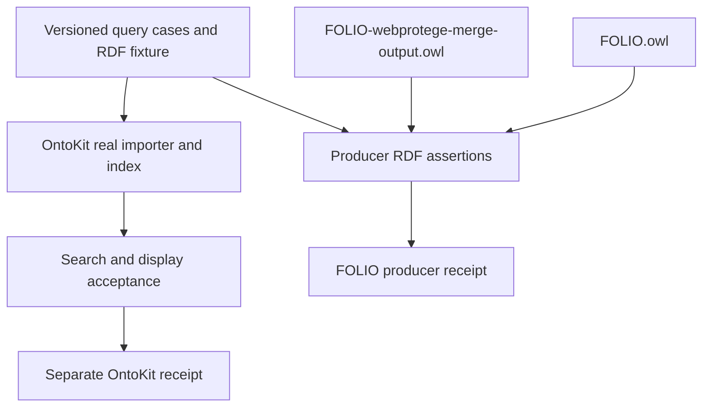

# Hidden-label Search Coverage - Plan

## Goal Capsule

- **Objective:** FOLIO and OntoKit maintainers can verify that the approved Agreements aliases find the intended concept and can distinguish verified coverage from pending viewer work.
- **Means:** A portable acceptance corpus, producer regression tests, and a downstream acceptance handoff (KTD1–KTD4).
- **Authority:** The controller's `foli-5` mandate; chief repository `docs/plans/2026-10-26-0705-feat-codex-drawdown-campaign-plan.md` Goal Capsule and campaign R11, R15, R16, R17, R19, R20; this repository's `AGENTS.md`; and the origin plan's remaining OntoKit coordination work. Campaign IDs refer to that external plan, not the local requirements below.
- **Authority limitation:** The chief checkout and campaign plan are absent from this sandbox. Only the controller-supplied rule excerpts were available. The controller must provide or verify the named Goal Capsule and cited requirements before authorizing the build; this document does not claim that comparison occurred.
- **Execution profile:** This delivery is planning only. The subsequent build runs `lfg` against this plan on `drawdown/foli-5`, with local commits only. The controller scans, pushes, and opens the PR; the campaign gate owns merge (campaign R15, R17, R19).
- **Stop conditions:** Apply R6 to any scope expansion or protected operation. Missing consumer evidence prevents a viewer-completion claim, while FOLIO-side coordination remains independently deliverable under R5.
- **Completion owners:** The FOLIO lane delivers U1–U3; the controller verifies campaign authority and Cockpit attribution; the `foli-3`/OntoKit lane supplies actual consumer acceptance evidence.

---

## Product Contract

### Summary

Add a small RDF/XML fixture and machine-readable query cases that both repositories can use to check hidden-label support.
Validate the corpus against FOLIO's source and WebProtégé output, and document the evidence needed from OntoKit's real import, search, and presentation paths.

### Problem Frame

The origin plan completed the six-term Agreements rebuild and the merge-pipeline fix, but left viewer search coverage open.
Current FOLIO files contain the terms; the existing tests exercise synthetic merge cases rather than a reusable real-concept search corpus.
Without a shared acceptance contract, correct exported RDF can be mistaken for working viewer search, or later consumer tests can miss the hidden-label omission.

### Reverified Starting State

Static inspection on `417a5e2ece96b011d4209986aa8a5a454c521cca` found:

| Surface | Observed state | Planning consequence |
|---|---|---|
| `FOLIO.owl` and `FOLIO-webprotege-merge-output.owl` | Agreements `https://folio.openlegalstandard.org/R88D8i8AcSTUig2X3yPbFHg` contains untagged `Accord`, `Accords`, `Pact`, `Pacts`, `Compact`, `Compacts` as hidden labels | Preserve the completed rebuild; validate both artifacts |
| Agreements visible annotations | `rdfs:label` is `Agreements`; `skos:prefLabel` is `Contracts`; untagged `Agreement` and `Contract` are alternative labels | Preserve consumer display precedence and existing visible-label lookup |
| Language overlap | Alternative `Accords`@fr-fr coexists with untagged hidden `Accords` | Compare complete literal identity; use another term to prove hidden-only matching |
| Precision controls | Obligation `RDtFkLR3v97fran5zQ3ugao` has preferred label `Covenant`; Indenture `R8NLKPDCyexTiBJCz8mdsjz` has label `Indenture` | Preserve these owners and excluded Agreements terms |
| Merge implementation | `compute_semantic_diff` normalizes plain/`xsd:string` literals; `apply_changes` inserts hidden labels through the shared label path | Add coverage using existing behavior; no merge refactor is planned |
| Tests and CI | `tests/test_webprotege_label_additions.py` covers synthetic insertion/movement; `.github/workflows/tests.yml` discovers all tests with pytest | Add focused tests without changing workflow configuration or dependencies |
| Consumer implementation | No OntoKit checkout is present; the census describes an older `LABEL_PROPERTIES` omission | Reinspect downstream code before treating the historical claim as current |

No tests, merge generation, viewer execution, provider calls, or CI runs were performed during planning.
Historical passing-suite counts in status documents are not fresh acceptance evidence.
The branch was initially clean and has no git remote.

### Requirements

**Shared coverage**

- R1. Provide a portable corpus for all six approved hidden terms, visible-label controls, and the existing Covenant/Indenture owners, using stable full concept IRIs and explicit predicate/literal provenance.
- R2. Consumer acceptance must demonstrate hidden-label contribution through the actual import/index/search path, while preserving existing visible-label lookup, display selection, and one result per concept IRI.
- R3. Preserve language-aware RDF identity and the rejected-term boundary: do not attach Covenant(s), Indenture(s), Concordat(s), or Undertaking(s) to Agreements as hidden labels, or duplicate untagged Agreement/Contract into its hidden-label predicate.

**Evidence and compatibility**

- R4. Add offline tests for the corpus, both committed OWLs, and the merge output; existing tests remain intact and must keep passing (campaign R15, R16).
- R5. Record producer verification separately from downstream acceptance, with revisions and actual results for each; FOLIO coordination can complete without claiming that unverified OntoKit behavior is fixed.
- R6. Keep this item inside FOLIO coordination: no ontology edits/regeneration, IRI minting, migration, data rewrite, package release, new dependency/service, credential/security change, spend, sends, deletion, remote setup, or deployment change. Any frontend change would require separate scope and a committed Playwright screenshot under `docs/plans/evidence/` (campaign R11, R15–R17, R19, R20).
- R7. Leave a reviewable local commit and accurate top-level `STATUS-*.md`/`NEXT-*.md` records with `STATE:` lines; the controller must verify their attribution to repository ID `folio`.

### Key Decisions

- **Expansion delivery follows the campaign's guardrails** (session-settled: user-directed — chosen over holding every expansion for personal review: authorized expansions proceed through tests and review). Governs R4, R6, R7.
- **No work waits on a new personal response through 2026-10-30** (session-settled: user-directed — chosen over pausing for routine decisions: the campaign requires autonomous progress). Governs R5, R7; missing infrastructure evidence is assigned to the controller.

### Acceptance Examples

- AE1. Covers R1, R2. Importing the corpus through OntoKit and querying each approved hidden term returns the Agreements IRI once. A `Pact` or `Compact` probe establishes hidden-label contribution independently of visible aliases.
- AE2. Covers R2, R3. A match on untagged hidden `Accords` does not replace the displayed concept name. The independently asserted French alternative `Accords` remains eligible under the consumer's existing language/display policy.
- AE3. Covers R1, R3. `Covenant` retains its Obligation owner and `Indenture` its own class. Neither is asserted as an Agreements hidden label; broad fuzzy-search membership is not required to be empty.
- AE4. Covers R4, R5. If only the merged output loses `Pact`, producer coverage fails with the artifact and case identified, even though the source remains correct. If producer checks pass but no consumer receipt exists, viewer acceptance remains pending.

### Scope Boundaries

In scope: the shared corpus, its source/merge regression tests, downstream acceptance instructions, and continuity records.
The historical rebuild plan remains the record of the completed label work.

#### Deferred to Follow-Up Work

The downstream viewer implementation and live acceptance belong to `foli-3` and the OntoKit lane.
Release A/B canaries, general offline readiness reporting, README usage examples, and broad test/dependency hygiene belong to the other mandate items.
The stale synonym branch remains untouched.

#### Considered and Not Built

A FOLIO reference search engine would prove the behavior of a replacement matcher rather than OntoKit, so it is excluded.
A generic schema framework, checker CLI, new CI job, and whole-ontology hash gate add maintenance without improving this small corpus; reconsider only if multiple consumers need tooling beyond the fixtures and existing pytest suite.
New tokenization, ranking, language fallback, stemming, or alias expansion policies are excluded because the current consumer behavior has not been inspected.

---

## Planning Contract

### Assumptions

- The bounded interpretation of `foli-5` is a reusable FOLIO acceptance contract and handoff; `foli-3` owns the actual viewer change. This scope distinction follows the two mandate entries but has not been confirmed through current OntoKit source.
- The small RDF/XML projection will be useful to OntoKit's tests. Import compatibility remains downstream verification; additional fixture context must come from the original ontology rather than invented production concepts.
- The controller can supply the campaign excerpt and run Cockpit outside this sandbox. Neither capability is established here, and no credentials will be sought to obtain it.

### Key Technical Decisions

- KTD1. **Keep expectations independent of extraction.** Store a versioned JSON case table at `qa/ontology/search/hidden-label-cases.json` and a minimal RDF/XML corpus at `qa/ontology/search/hidden-label-fixture.owl`. The table carries stable case IDs, queries, full target IRIs, predicate, lexical form, language/datatype, and separate producer versus consumer expectations. Pin the six required cases independently so an empty or truncated table cannot become skipped coverage. Record a source revision for provenance; compare only the documented annotation projection to current OWLs. This implements R1, R4 without freezing unrelated ontology content.
- KTD2. **Use RDF comparisons and existing test patterns.** Add `tests/test_hidden_label_search_contract.py`, reusing RDFLib and the parse/apply/reparse pattern in `tests/test_webprotege_label_additions.py`. Treat plain and `xsd:string` literals as equivalent while retaining language tags, consistent with `tests/test_webprotege_literal_normalization.py`. A narrow test helper is sufficient; there is no new production validator. This implements R3, R4 and the final-artifact lesson in `docs/solutions/logic-errors/merge-pipeline-reported-changes-it-never-applied.md`.
- KTD3. **Make hidden-only attribution and presentation separate checks.** Preserve predicate provenance in the corpus. For R2, downstream evidence uses indexed provenance where available or a paired import omitting the sentinel's hidden annotation to establish its contribution. A broad full-text result alone is insufficient. Display checks prevent promotion of hidden annotations into visible fields, while allowing the same spelling when independently asserted under a visible predicate. This follows [SKOS labeling semantics](https://www.w3.org/TR/skos-reference/#labels); language/typed-literal equality follows [RDF 1.1 literal identity](https://www.w3.org/TR/rdf11-concepts/#section-Graph-Literal).
- KTD4. **Separate delivery from consumer acceptance.** `docs/hidden-label-search-contract.md` is the reusable specification and handoff. It names the actual downstream import/query/display checks and a receipt format, without assuming current OntoKit implementation paths or declaring them verified. The historical `ontokit-api/ontokit/services/ontology_index.py` pointer is labeled as such. This implements R5 and avoids the false integration confidence documented in `docs/solutions/integration-issues/keyless-canary-for-workflow-run-dispatch-chain.md`.
- KTD5. **Use the existing delivery path.** Existing pytest discovery covers the new tests, and new hidden-label-specific status/next files keep unrelated ontology QA state untouched. The build follows the campaign's local-only branch ownership under R6, R7. Local model work remains Astra; cloud builds use the platform default Sol with the campaign's Astra/Fable review gate (session-settled: user-directed — chosen over the Sol-first local ladder and changing cloud defaults: preserve the campaign's settled execution choices).

### High-Level Technical Design

The left branch is verified by this item.
The right branch defines downstream evidence and is executed by the consumer lane.
Passing producer assertions cannot imply that the right branch passed.

### Risks and Dependencies

The primary false-positive risk is matching `Accords` through its French alternative label; KTD3 uses a hidden-only sentinel.
Shared mutable graphs or expectations derived from the extractor can hide omissions; KTD1–KTD2 require independent expectations and isolated mutation inputs.
The small fixture cannot establish production reindexing behavior; the consumer receipt must identify whether an existing imported ontology was refreshed as well as whether a fresh fixture import passed.

**Blocking before build:** the controller must verify the missing chief Goal Capsule and campaign R11, R15, R16, R17, R19, R20 against this plan.
**Pending external verification:** the Cockpit scanner is not available here; attribution cannot be claimed from filenames alone.
**Deferred to consumer execution:** current OntoKit code locations, import requirements, existing display precedence, exact-query semantics, and index refresh procedure must be inspected in its checkout.
These are technical ownership/evidence dependencies; none requests a new personal decision.

---

## Implementation Units

### U1. Publish a portable acceptance corpus

**Goal:** Give both repositories the same explicit inputs and expected concept identities.
**Requirements:** R1, R3, R4; AE1–AE3.
**Dependencies:** Controller authority verification described above.
**Files:** Create `qa/ontology/search/hidden-label-cases.json`, `qa/ontology/search/hidden-label-fixture.owl`, and `tests/test_hidden_label_search_contract.py`.

**Approach:**

1. Define the KTD1 case table with source revision and complete literal metadata.
2. Build the small corpus from existing Agreements, Obligation, and Indenture declarations and relevant label assertions; document the selected projection.
3. Add corpus-integrity checks and explicit hidden-only sentinel requirements without implementing a search matcher.

**Patterns to follow:** JSON case data under `qa/ontology/`; small RDF/XML and parameterized assertions in the existing annotation and merge tests.
**Execution note:** Establish the independent case inventory before deriving any fixture data.

**Test scenarios:**

- Each of the six required terms has a distinct case ID and the correct Agreements IRI/predicate/literal metadata.
- An empty case table, duplicate ID, omitted required alias, unsupported predicate, or missing expected IRI fails explicitly rather than silently skipping coverage.
- Covers AE2. Untagged hidden `Accords` and French alternative `Accords` stay distinct, while plain and `xsd:string` spellings compare equivalently.
- Covers AE3. Covenant/Indenture owner assertions and Agreement/Contract visible-alias controls are present with their correct predicates.
- `Pact` and `Compact` are verified as hidden-only label matches on Agreements in the corpus, so the downstream sentinel cannot be satisfied by a copied visible alias.

**Verification:** The RDF/XML parses, every case has a checked expectation, and the corpus carries enough provenance to be consumed without copying expectations from prose.

### U2. Guard source and exported RDF against regression

**Goal:** Detect missing or misattributed terms in the actual FOLIO artifacts and merge result.
**Requirements:** R3–R5; AE3, AE4.
**Dependencies:** U1.
**Files:** Extend `tests/test_hidden_label_search_contract.py`; read `FOLIO.owl`, `FOLIO-webprotege-merge-output.owl`, and the U1 corpus without modifying them.

**Approach:**

1. Compare the selected RDF projection against each committed OWL independently using KTD2.
2. Exercise the existing merge functions with a temporary baseline missing the six hidden terms, then inspect the emitted RDF and a second diff.
3. Exercise narrowly scoped mutation inputs to show that the test helper catches the historical omission and precision failure modes.

**Patterns to follow:** `tests/test_webprotege_label_additions.py`, `tests/test_webprotege_literal_normalization.py`, and actual-graph assertions in `tests/test_webprotege_fidelity.py`.

**Test scenarios:**

- All required annotation tuples appear in both real artifacts; XML order differences do not matter.
- Covers AE4. Removing `Pact` only from a temporary merged graph fails the output check while the unchanged source passes.
- Changing one required hidden literal's language or moving it to another concept fails with artifact and case context.
- Covers AE3. Adding an excluded hidden term or duplicating untagged Agreement/Contract on Agreements fails, while the legitimate French `Accords` alternative remains valid.
- Applying the existing merge to the corpus restores all six hidden labels, preserves the visible and precision-control annotations, and leaves no pending label additions on a second comparison.
- Independent mutation cases leave their source fixtures untouched and do not contaminate later cases.

**Verification:** Focused coverage and the existing full pytest suite pass. Authoritative OWL files and production merge code remain unchanged.

### U3. Deliver the OntoKit acceptance handoff

**Goal:** Make the shared corpus actionable while keeping the viewer gap visible until real evidence exists.
**Requirements:** R2, R5–R7; AE1, AE2, AE4.
**Dependencies:** U1, U2.
**Files:** Create `docs/hidden-label-search-contract.md`; update `STATUS-HIDDEN-LABEL-SEARCH.md` and `NEXT-HIDDEN-LABEL-SEARCH.md`.

**Approach:**

1. Document corpus consumption and the KTD3–KTD4 acceptance boundary, including fresh import and refresh/reindex evidence for existing data.
2. Provide an unsent downstream work brief and an empty receipt template: FOLIO source/corpus revision, OntoKit revision, tested import/search/display path, actual test commands/results, and evidence paths.
3. Update the continuity pair with actual producer results and genuine remaining consumer/controller actions; verify Cockpit attribution when the scanner is available.

**Test expectation:** No new runtime tests for documentation alone; U1–U2 cover the shipped data contract.
**Verification:** Every referenced fixture and test exists, downstream examples use the same case IDs, no consumer result is invented, and R7's scanner receipt is present or explicitly pending with controller ownership.

---

## Verification Contract

Execution uses the existing Python 3.12 CI environment and `scripts/requirements.txt`; no dependency or workflow change is needed.
The commands below are build acceptance targets and were not run during planning.

| Check | Evidence required |
|---|---|
| Focused suite | `python -m pytest tests/test_hidden_label_search_contract.py tests/test_webprotege_label_additions.py tests/test_webprotege_literal_normalization.py -q` passes, including AE3–AE4 producer checks |
| Existing suite | `python -m pytest tests -q` passes with no removed/weakened tests or new silent skips |
| Scope and diff | Only declared fixture/test/doc files change; both OWLs, production code, dependencies, and workflow configuration retain their original content |
| Downstream contract | AE1–AE2 specify real import/index/query/display evidence; any absent result remains pending under `foli-3` |
| Continuity | Top-level state/actions link to this plan; a real Cockpit scan attributes them to `folio`, or controller verification is explicitly outstanding |
| Frontend evidence | Not applicable to this FOLIO corpus/documentation build; R6 governs any separately authorized frontend change |

No provider-backed canary, production ontology mutation, release, or live search probe is an acceptance step for this item.
The campaign's implementation/simplification/review gate still applies to the build, including Astra/Fable review as required by the controller.

---

## Definition of Done

U1 supplies the portable, independently specified corpus; U2 proves its producer and merge invariants; U3 provides the usable downstream contract and truthful continuity records.
All local requirements map to those units, relevant tests pass, and no abandoned implementation attempt remains in the final diff.
The result is committed on `drawdown/foli-5` for controller publication.
A completed FOLIO handoff does not close the separate viewer acceptance work without its consumer receipt.

### Sources

- `docs/plans/2026-10-20-001-agreements-hidden-labels-plan.md`: approved term set, excluded terms, completed merge fix, and remaining viewer work.
- `docs/2026-08-05-staged-change-census.md`, section 4: historical consumer indexing pointer, requiring fresh downstream inspection.
- `docs/FOLIO-CHANGE-POLICY.md`, sections 1, 2, and 7: collision consequences, stable IRIs, and label checks; the policy is marked proposed.
- `docs/solutions/conventions/minting-folio-concept-iris.md`: existing identity must be preserved.
- `docs/handoffs/2026-10-20-release-a-canary-and-qa-residuals.md`: separate canary scope and evidence limits.
- [Pytest parametrization](https://docs.pytest.org/en/stable/how-to/parametrize.html): empty parameter sets and shared parameter objects inform corpus completeness and isolation checks.
