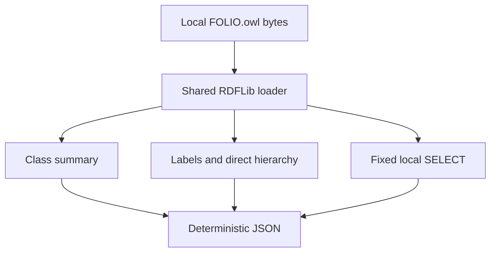

# FOLIO Usage Examples and Documentation - Plan

## Goal Capsule

- **Objective:** A new FOLIO consumer can understand the ontology and obtain useful results from the checked-in data by following the repository's documentation.
- **Means:** Markdown guides and three small, offline RDFLib examples, covered by the existing pytest suite (KTD1-KTD4).
- **Scope:** Mandate item `foli-6`, kind `expansion`, on `drawdown/foli-6` only.
- **Authority:** The controller mandate, repository `AGENTS.md`, and the chief repository's `docs/plans/2026-10-26-0705-feat-codex-drawdown-campaign-plan.md`. Campaign R11, R15, R16, R17, R19 and R20 are cited as supplied by the controller; the chief source is unavailable in this sandbox and requires the reconciliation described below.
- **Execution profile:** This stage produces and commits the plan and continuity records only. Implementation and runtime verification belong to the subsequent build stage.
- **Stop conditions:** Preserve the boundaries in R6-R8; a failed check is evidence to report, not permission to weaken a test or change ontology data.
- **Tail ownership:** The controller supplies the missing authority excerpts, verifies Cockpit attribution to `folio`, scans the branch, pushes it and opens the PR. The campaign merge gate owns merging under Campaign R15 and R19.

---

## Product Contract

### Summary

Replace the two README promises with linked consumer documentation and executable examples for loading FOLIO, inspecting labels and direct hierarchy, and querying local class data.
Teach what the checked-in RDF actually represents and how to reuse its identifiers without requiring provider access.

### Problem Frame

At baseline commit `417a5e2`, `README.md` advertises `documentation/` and `examples/` as “coming soon”; neither directory exists.
Getting Started refers readers to missing implementation guidance, and the generic integration paragraph mentions an API without supplying an endpoint or implementation contract.
Existing scripts and documentation primarily serve ontology authoring and QA, so a consumer must reconstruct basic usage from internal code.

Static inspection confirms an RDF/XML source, an existing RDFLib dependency, and a CI job that collects all tests under `tests/`.
This is starting-state evidence, not a passing test baseline; no tests were run during planning.

### Requirements

**Consumer guidance**

- R1. The README's `documentation/` and `examples/` entries shall lead to maintained local content that lets a reader set up and run a first example.
- R2. The guides shall explain canonical input, opaque permanent IRIs, class versus property subjects, label predicates and literal metadata, direct hierarchy, restrictions, deprecation, and snapshot provenance using checked-in evidence.
- R3. The examples shall demonstrate loading and summarizing classes, inspecting a known concept, and executing a bounded local SELECT query with documented successful and unsuccessful outcomes.

**Correctness and preservation**

- R4. Examples shall preserve the distinction between asserted RDF data and inferred meaning, retaining label multiplicity and metadata without treating restriction nodes as named parents.
- R5. Once dependencies are installed, all examples shall operate on local files without credentials, network access, import resolution, or source-file changes.
- R6. New behavior shall have automated tests, and existing tests shall remain intact and pass without weakening assertions; failures caused by the sandbox or existing debt must be reported accurately.

**Delivery boundaries**

- R7. Work shall remain within `foli-6`: consumer docs, examples, their tests, narrow README integration and required continuity records. Ontology bytes, provider workflows, schemas, releases, deployment configuration and external services remain outside this change.
- R8. Delivery shall use the current item branch and local commits, leaving publication to the controller and preserving Campaign R11/R15/R16/R17/R19/R20 as supplied in the mandate.

### Key Decisions

- **Tested expansions use the campaign merge gate.** Governs R6 and R8. (session-settled: user-directed — chosen over holding every expansion for personal review: the campaign delegates routine delivery behind its guardrails.)

### Scope Boundaries

The guides describe consumption of existing ontology data.
The separate `CONTRIBUTING.md` promise, broad README QA claims, proposed change-policy mechanisms and other mandate items are not rewritten under R7.
No hosted documentation site, browser UI, SDK, general search engine, arbitrary query runner, recursive traversal or OWL reasoner is needed for these examples.
These mechanisms would add interfaces beyond the missing onboarding material; a later request for such an interface would change that decision.

The example scripts may show `skos:hiddenLabel` data, but they do not implement OntoKit search or claim viewer parity.
Full provider qualification and the real model-bearing canary belong to their existing plans.

### Acceptance Examples

- AE1. Covers R1, R3 and R5. A reader follows the README, installs the stated dependency, and runs the examples against local `FOLIO.owl` without any provider configuration.
- AE2. Covers R3 and R4. A known class has two named parents, a restriction and several language-tagged labels; inspection retains both parents and each literal's metadata while excluding the restriction from the parent list.
- AE3. Covers R3. Inspecting an unknown or non-class IRI fails clearly; inspecting a known class with no labels succeeds, and a SELECT with no matching rows succeeds with an empty result.

---

## Planning Contract

### Key Technical Decisions

- KTD1. **Use the existing RDFLib approach with a small consumer dependency file.** `examples/requirements.txt` contains the repository's current `rdflib>=7.0.0,<8.0.0` bound, taken from `scripts/requirements.txt`. Document Python 3.12, the existing CI runtime. Consumers do not need the entire authoring/QA dependency set. Dependency acquisition is setup; R5 applies after setup.
- KTD2. **Share one local loader across three import-safe teaching scripts.** `examples/load_and_inspect.py` owns loading and a summary of triples and explicitly declared named OWL classes. Resolve the default `FOLIO.owl` from the script location, following `scripts/mint_iri.py`; parse local bytes as RDF/XML, following `scripts/ontology_qa/delta.py`. An explicit ontology argument is a local path, never a URL source. No ontology serialization is part of these examples.
- KTD3. **Keep inspection and query semantics explicit.** `examples/labels_and_hierarchy.py` requires a full IRI identifying an explicitly declared named OWL class. It lists all values of `rdfs:label`, `skos:prefLabel`, `skos:altLabel` and `skos:hiddenLabel`, preserving term kind, lexical value, language and datatype. Direct parent/child neighbors are URI-valued `rdfs:subClassOf` endpoints; they need not have their own explicit class declaration. Show deprecation annotations for the inspected class and its neighbors, including absent annotations as absence rather than proof of active status. Do not select a display name from hidden labels or apply a language fallback.
- KTD4. **Use one fixed read-only query with bound parameters.** `examples/query_classes.py` selects explicitly declared named classes, optional label values and deprecation data. An optional parent argument binds a URI term and restricts results to direct children; it never enters query text by string interpolation. Order results deterministically and limit output to 20 solution rows. Explain that rows may repeat a class and truncate its label set; complete inspection belongs to KTD3. Known unlabeled classes remain eligible. No-match queries return empty rows, including an unmatched parent IRI; this is not concept-existence validation.
- KTD5. **Make successful output easy to inspect and reuse.** Emit deterministic, Unicode-preserving JSON with sorted collections. Bound the overview sample to 10 classes; identify full IRIs in every result. Missing/unreadable/malformed inputs and unknown inspection subjects produce a useful stderr message and nonzero exit status. Help and usage remain ordinary argparse text. Avoid a versioned output schema or a new CLI framework.
- KTD6. **Publish plain Markdown in the promised directories.** Put the consumer quick start in `documentation/README.md`, data semantics in `documentation/ontology-model.md`, and command/output guidance in `examples/README.md`. Link existing authoring and licensing guidance instead of duplicating it. Correct only the README onboarding/API wording necessary to make the new local path truthful.
- KTD7. **Use focused tests collected by existing CI.** `.github/workflows/tests.yml` already installs RDFLib and runs `python -m pytest tests -q`. Add `tests/test_consumer_examples.py` and `tests/test_consumer_documentation.py`; do not change the workflow. Prefer compact RDF fixtures, reuse one parsed real graph for integration assertions, and avoid golden corpus counts.
- KTD8. **Preserve the campaign execution choice.** Local planning/build work uses Astra; cloud builds use the cloud default and retain the required Astra/Fable PR reviews under R8. (session-settled: user-directed — chosen over the Sol-first local ladder: the campaign fixes the model route.)

### Assumptions

These are bounded planning defaults, not additional user decisions: the first examples serve Python-capable consumers; Markdown is the appropriate publication surface for this repository; three small scripts are enough to demonstrate useful consumption.
The docs include deprecated concepts as inspectable data, leaving application-specific active-only filtering to consumers.
These defaults are reversible within R1-R7 and require no new service or product decision.

### Output Structure

```text
documentation/
  README.md
  ontology-model.md
examples/
  README.md
  requirements.txt
  load_and_inspect.py
  labels_and_hierarchy.py
  query_classes.py
tests/
  test_consumer_examples.py
  test_consumer_documentation.py
```

### Technical Shape



### Dependencies and Evidence Gaps

The chief campaign plan and Cockpit scanner are absent from the sandbox.
Before build, the controller must reconcile this plan with that plan's Goal Capsule and Campaign R11/R15/R16/R17/R19/R20; the supplied mandate remains the available scope authority.
This is a missing controller artifact, not a request for a new product decision.

Actual Cockpit attribution to repository ID `folio` remains unverified until the controller runs its scanner.
The top-level continuity files make the state discoverable, but file naming alone is not proof of scanner attribution.

The ontology change policy contains proposals: versioned endpoints, replacement metadata and release files must not be described as implemented facilities.
Likewise, the dated keyless canary evidence does not establish a completed provider-backed release.

---

## Implementation Units

### U1. Provide a local loading example

**Goal:** Give a consumer a first successful, read-only inspection.

**Requirements:** R3, R5, R6; AE1. **Dependencies:** Controller authority reconciliation above.

**Files:** Create `examples/requirements.txt`, `examples/load_and_inspect.py`, and `tests/test_consumer_examples.py`.

**Approach:** Apply KTD1, KTD2 and KTD5 with a reusable loader and callable summary logic behind the script entry point. Include named explicit classes in the summary; labeled properties and blank-node class expressions are not counted as named classes.

**Patterns to follow:** `scripts/mint_iri.py` for CLI/default-file conventions; `scripts/ontology_qa/delta.py` for byte parsing; `tests/test_hydration_delta.py` for small RDF fixtures.

**Test scenarios:**

1. A small graph with named classes, a labeled property and a blank node produces the correct class count and sorted, bounded sample.
2. Missing and malformed local files yield useful nonzero CLI failures without a success payload; URL-shaped input is never fetched.
3. A CLI invocation from another working directory honors an explicit fixture path and the script-relative default source path.
4. Successful loading leaves input bytes unchanged and performs no network requests.

**Verification:** The new unit tests establish the local-loading contract, and a real-corpus smoke returns a nonempty summary without fixing an exact total count.

### U2. Demonstrate concept inspection and local queries

**Goal:** Let consumers inspect real identifiers and obtain useful class-query results without losing RDF meaning.

**Requirements:** R2-R6; AE2 and AE3. **Dependencies:** U1.

**Files:** Create `examples/labels_and_hierarchy.py` and `examples/query_classes.py`; extend `tests/test_consumer_examples.py`.

**Approach:** Apply KTD3-KTD5, reusing U1's loader. Use the published Investment Funds IRI `https://folio.openlegalstandard.org/RCzxVprwB3RwZ8EMewt18Jt` in the documented inspection and parent-query examples. Verify its direct Co-Investment Fund child `https://folio.openlegalstandard.org/R1cNH7TLMiSlSbIbdFsynUk` against the checked-in data during build.

**Patterns to follow:** `scripts/ontology_qa/records.py` for term metadata; `scripts/ontology_qa/context.py` for URI-valued neighbors. Its use of the word “ancestors” must not turn immediate parents into a claim of transitive traversal.

**Test scenarios:**

1. Covers AE2. Repeated labels, Unicode, untagged values, regional language tags and explicit datatypes survive inspection with predicate identity and stable ordering; a nonliteral object is not mislabeled as a text literal.
2. Covers AE2. Two direct parents, a grandparent, a child, an undeclared named neighbor and a blank-node restriction produce only the expected immediate URI neighbors.
3. Covers AE3. A known unlabeled class succeeds with empty label arrays; unknown, blank, relative and property IRIs fail inspection without applying the current minting regex to historical identifiers.
4. A deprecated class with retained edges remains visible with its annotations; missing deprecation data is not rewritten as an explicit false assertion.
5. A query excludes labeled properties, includes unlabeled classes, safely binds the parent IRI, returns only direct children when constrained, and succeeds empty when nothing matches.
6. A multi-label fixture proves deterministic ordering and the 20-row bound without implying 20 distinct classes or complete label sets.
7. Reuse one real-corpus graph to prove the published parent/child relation and useful query rows. Run both CLI entry points with fixture input from another working directory and verify unchanged source bytes.

**Verification:** All focused tests pass; the documented real-data commands produce interpretable results under R5. No real-data mutation is used to make an example pass.

### U3. Publish and connect the guides

**Goal:** Replace the missing onboarding path with clear, navigable instructions tied to the tested examples.

**Requirements:** R1-R8; AE1. **Dependencies:** U1 and U2.

**Files:** Create `documentation/README.md`, `documentation/ontology-model.md`, `examples/README.md`, and `tests/test_consumer_documentation.py`; update `README.md`, `STATUS-DRAWDOWN-FOLI-6.md`, and `NEXT-DRAWDOWN-FOLI-6.md`.

**Approach:** Apply KTD6 and KTD7. Explain setup versus offline execution, each command's inputs and output limits, literal metadata, multiple inheritance, restrictions, deprecation, and pinning a repository snapshot. Describe results as represented ontology data, without asserting legal correctness. Preserve the unrelated README sections under R7.

**Patterns to follow:** Link `docs/solutions/conventions/minting-folio-concept-iris.md` for identifier authoring and `docs/FOLIO-CHANGE-POLICY.md` for change considerations while distinguishing proposals from current capabilities. Follow `AGENTS.md` for continuity records.

**Test scenarios:**

1. The two promised README links and local links within the new guides resolve to tracked files; deliberately broken fixture links are detected by the scoped check.
2. The guides' named example entry points exist and correspond to the tested commands, without asserting prose snapshots or globally banning every “coming soon” phrase.
3. Follow the documented setup and examples in a clean Python environment during build; confirm the first useful result requires no QA/provider configuration.

**Verification:** A cold reader can reproduce AE1. `NEXT-DRAWDOWN-FOLI-6.md` contains only genuine remaining actions, and the controller records actual Cockpit attribution or a precise unresolved scanner limitation.

---

## Verification Contract

Runtime checks below belong to build, not this planning stage.
Establish the existing suite baseline before implementation so failures are attributable; preserve existing assertions under R6.

| Check | Evidence required |
| --- | --- |
| Focused behavior | `python -m pytest -q tests/test_consumer_examples.py tests/test_consumer_documentation.py` passes for U1-U3. |
| Existing regression suite | `python -m pytest tests -q` passes in the existing development/CI environment; report baseline or sandbox failures separately. |
| Documented commands | All three commands from `examples/README.md` run against checked-in `FOLIO.owl`; compare source hashes before and after. |
| Offline execution | Fixture/CLI checks prevent network access and still pass after dependencies are installed; malformed and missing inputs fail clearly. |
| Scope review | Ontology files, existing tests, QA policy, workflows and deployment settings have no unintended diff; no new service or release artifact appears. |
| Documentation integrity | Scoped local-link and entry-point checks pass; sample counts are illustrative rather than asserted forever. |
| Controller continuity | Reconcile the missing campaign excerpts and verify STATUS/NEXT attribution to `folio` using the actual Cockpit scanner. |

The existing annotation census may report known legacy debt; a tutorial change does not authorize its repair or suppression.
This plan changes Markdown and CLI examples only, so a frontend screenshot is not applicable.
If build scope introduces a frontend change, Campaign R15/R16 require a Playwright screenshot committed under `docs/plans/evidence/` and a `SCREENSHOT:` receipt.

---

## Definition of Done

- U1-U3 satisfy R1-R8 and their verification outcomes, with useful offline examples and functioning README entry points.
- Existing tests are neither removed nor weakened, and build evidence distinguishes passing checks from unavailable or failing checks.
- No ontology, provider, deployment, schema, package-release or external-service change is bundled with the documentation expansion.
- Abandoned experimental code and temporary outputs are absent from the commit; the guides reference only delivered behavior.
- Top-level STATUS/NEXT records report the actual state, remaining actions and controller verification gaps without claiming an unperformed scan.
- The controller receives the local branch and verification evidence for publication; no login, remote setup or personal decision is required from this lane.
