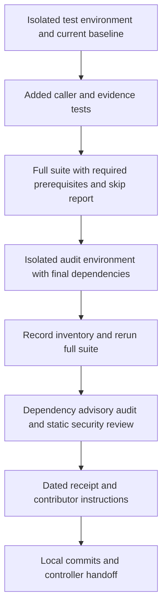

# FOLIO Maintainer Hygiene - Plan

## Goal Capsule

- **Objective:** Contributors can check routine FOLIO changes with reliable tests, understand dependency and security findings, and follow instructions that match the repository.
- **Means:** Extend the existing pytest and GitHub Actions paths, exercise missing command-line contracts, and retain a dated audit receipt (KTD1–KTD5).
- **Authority:** Drawdown mandate item `foli-7` only, classified as hygiene; the campaign handoff reports it as `planned`. Repository `AGENTS.md` and `docs/FOLIO-CHANGE-POLICY.md` govern local work. The chief campaign authority is `docs/plans/2026-10-26-0705-feat-codex-drawdown-campaign-plan.md`, especially its Goal Capsule and Campaign R11, R15, R16, R17, R19, and R20.
- **Execution profile:** Establish a fresh baseline during the build stage, add characterization tests before any necessary fix, then verify dependencies, audit results, and contributor instructions. This document's planning stage executes no tests or implementation.
- **Stop conditions:** Preserve failing evidence when required dependencies, tests, or audit coverage are incomplete; do not obtain a pass by weakening controls (R1, R5, R8). Continue independent authorized work and report the remaining gap.
- **Tail ownership:** Work stays on `drawdown/foli-7` and is committed locally. The controller owns publication and hosted CI evidence; the campaign gate owns merge and required reviews (R7).

---

## Product Contract

### Summary

Close missing tests around documented ontology commands and evidence handling, make required test prerequisites explicit in existing CI, and audit the dependencies actually tested.
Publish contributor verification instructions and a dated receipt that distinguishes local checks from hosted and provider-backed qualification.

### Problem Frame

The repository already has substantial deterministic coverage, but most tests exercise functions rather than the commands contributors and workflows call.
The IRI suite can skip at module import when `folio.iri` is missing, so a green pytest result alone does not establish that the published-identifier checks ran.
Dependencies use compatibility ranges without a recorded resolved vulnerability audit, and the README mixes offline verification instructions with provider-backed correction operations.

Inspection at commit `417a5e2` found the following starting state; these observations are not fresh execution results.

| Surface | Verified evidence | Consequence for this item |
|---|---|---|
| Test inventory | 24 `tests/test_*.py` modules; static inspection counted 149 test functions before parameter expansion | Retain all existing tests; obtain actual collection/pass/skip counts during build |
| Existing CI | `.github/workflows/tests.yml` runs the full `tests` directory on PRs and pushes to `main`, using Python 3.12 | Extend this workflow rather than create another test workflow |
| Deterministic QA | `.github/workflows/ontology-hydration-qa.yml` also runs the suite in `deterministic-pr` | Keep its test setup consistent without changing trusted execution |
| Runtime dependencies | Six bounded direct dependencies in `scripts/requirements.txt`; authoring requirements include that file | Add test/audit tooling separately; keep runtime ranges unless evidence requires a compatible correction |
| Coverage gaps | Validator and IRI command modes lack caller-level coverage; extraction tests cover only success, digest mismatch, and traversal; replay CLI has a happy-path test | Add focused outcome tests, using existing fixtures and helpers |
| Release evidence | The latest handoff records the keyless canary complete and the full provider canary outstanding | Hygiene does not establish Release A/B provider qualification |

### Requirements

**Compatibility and coverage**

- R1. Preserve existing behavior, every existing test and assertion, published identifiers, ontology bytes, and QA policies; add regression coverage for any narrowly necessary fix.
- R2. Test the documented validator, IRI check/audit/mint wrapper, and offline replay commands for their applicable success, failure, output, and input-boundary contracts.
- R3. Test existing evidence extraction safeguards for unsafe members, corrupt or empty input, refusal to overwrite, and absence of partially published output.

**Contributor checks and audit**

- R4. Existing CI must continue running the full suite with explicit required IRI/ontology prerequisites and visible skip reporting, preserving workflow/job/check identities and trigger behavior.
- R5. Audit the resolved direct and transitive dependencies in an isolated tested environment, and review the existing workflow/evidence trust boundaries; retain findings and incomplete results without presenting either as a clean security result.
- R6. Contributor documentation must describe actual installation, test, census, replay, and audit behavior, including the distinction between baseline-relative validation and a full census with legacy debt.

**Delivery and evidence**

- R7. Keep one item on `drawdown/foli-7`, commit locally, and hand publication and merge to the controller; maintain top-level Cockpit state and genuine open actions attributed to repository ID `folio`.
- R8. Do not read credential material, call model providers, spend, send messages, change security settings, add outside services, migrate or rewrite data, release packages, or alter deployment configuration beyond the test setup named here. Do not add a remote or find credentials.
- R9. Identify each receipt's commit, environment, commands, results, and limitations; never substitute historical counts or static workflow assertions for current runtime evidence.

Campaign traceability: R1–R4 implement the preservation and testing guardrails supplied for Campaign R15/R16; R7 implements Campaign R17/R19; R8 implements Campaign R11 and the mandate hard stops; R9 carries Campaign R20's truthful blocker reporting. These are plan-local R-IDs, distinct from campaign R-IDs.

### Key Decisions

- **Durable hygiene is the selected scope.** Governs R1–R6. (session-settled: user-directed — chosen over speculative features: the campaign calls for maintenance after planned work and worthwhile expansions.)
- **Technical choices do not wait for Damien.** Governs R7–R9. (session-settled: user-directed — chosen over synchronous checkpoints: the campaign supplies zero user time through 2026-10-30.)

### Scope Boundaries

The change reaches test files, test/audit dependency declarations, the two existing deterministic test setups, and contributor/evidence documentation.
Production Python changes are permitted only for a defect demonstrated by the selected new tests and needed to preserve their existing contract.
No frontend change is planned; a Playwright screenshot is therefore inapplicable.

Considered and not included: a production lockfile, an arbitrary global coverage percentage, a custom audit-result engine, and a recurring audit workflow.
The mandate requires a tested environment and a dated audit, not identical future resolution or a new scheduled gate; reconsider those mechanisms only if later requirements demand those guarantees.

#### Deferred to Follow-Up Work

- `foli-1`/`foli-2`: live Actions/provider qualification and its credentials or spend.
- `foli-3`/`foli-5`: hidden-label viewer search and OntoKit coordination.
- `foli-4`: a new offline canary/readiness reporting capability.
- `foli-6`: the advertised ontology usage documentation and examples. Contributor test/audit instructions belong to this item.

---

## Planning Contract

### Key Technical Decisions

- KTD1. **Use documented commands and workflow call sites as the usage proxy.** No usage telemetry was supplied. Prioritize these caller boundaries over duplicating the already extensive merge, qualification, and correction unit suites. This implements R2/R3.
- KTD2. **Keep pytest and tiny local fixtures.** Extend the current `tmp_path`, subprocess, and evidence-helper patterns. Assert parsed output, exit status, and filesystem effects; detection counters alone previously hid a silent merge failure (`docs/solutions/logic-errors/merge-pipeline-reported-changes-it-never-applied.md`). Use the real upstream IRI dependency and stub only delegation/collision wiring where needed.
- KTD3. **Separate dependency purposes without changing production resolution policy.** Add `scripts/requirements-test.txt`, including runtime requirements plus a bounded compatible pytest version, and `scripts/requirements-audit.txt`, including the test set plus a pinned compatible pip-audit version. Both deterministic test setups consume the test manifest; the trusted model job retains its current runtime install. A normalized installed name/version inventory documents one resolution, not a lockfile ([pip repeatable installs](https://pip.pypa.io/en/stable/topics/repeatable-installs/)).
- KTD4. **Audit the environment after its final install and test run.** The audit environment contains runtime, test, and audit tooling dependencies, all included in the inventory and scan. Use pip-audit's installed-environment mode, strict handling of skipped dependencies, explicit PyPI advisory service, and a fresh JSON output path. PyPI is the package source already used by installation; this adds no service account or hosted integration. Do not use automatic fixes or advisory suppression. pip-audit 2.10.1 supports Python 3.12; verify that version when building ([official tool documentation](https://github.com/pypa/pip-audit#usage), [package metadata](https://pypi.org/project/pip-audit/)).
- KTD5. **Keep audit status separate from pytest status.** A complete-clean result requires exit success, a current valid report, complete package coverage, and zero findings. Completed findings retain package/version/advisory details; absent or invalid reports, skipped packages, and lookup failures are incomplete. Exit 1 alone cannot distinguish findings from fatal errors ([versioned CLI source](https://github.com/pypa/pip-audit/blob/v2.10.1/pip_audit/_cli.py)). Record the raw result and disposition in the receipt rather than introduce a new runtime status API.
- KTD6. **Make the existing IRI prerequisite explicit in CI.** Check `folio.iri` and the committed ontology files before pytest, retain existing local skip accommodation, and report skips with `-ra`. Skip reporting alone cannot make a missing drift ratchet fail ([pytest skip documentation](https://docs.pytest.org/en/stable/how-to/skipping.html)). Preserve the upstream-only generator and `KNOWN_NONCONFORMING` set (`docs/solutions/conventions/minting-folio-concept-iris.md`).

### Verification Flow

The diagram shows the build-stage evidence dependency; it does not introduce a new workflow or service.

### Assumptions and Evidence Limits

- The documented command/workflow proxy is an agent assumption about the most-used paths; no frequency claim is made.
- Python 3.12 is the support target for this maintenance work because both deterministic CI paths already select it. This does not establish a broader Python support matrix.
- The chief campaign repository is not mounted in this sandbox. Its Goal Capsule and cited R-ID source text could not be read; the supplied mandate is the available authority extract. The controller must reconcile the cited sections before build publication, without requiring a Damien decision.
- The Cockpit source tree and scanner are unavailable in this sandbox. Top-level continuity files can be checked locally for shape and `folio` attribution, but actual scanner attribution remains a controller verification action.
- Current test outcomes, package resolution, advisories, and hosted CI execution are build-stage evidence, not planning-time facts. The historical 191-pass receipt is not a new baseline.

### Sequencing and Risks

U1 establishes the fresh baseline and shared test setup. U2 and U3 add missing coverage. U4 audits the final dependency environment; U5 documents the resulting behavior and evidence.
Any remediation changing installed versions requires a new inventory, full suite, consistency check, and audit before the receipt is final.

Advisory availability is a network dependency. An unavailable audit stays incomplete and open under R5/R9; it does not justify acquiring credentials or weakening tests.
An advisory needing a breaking dependency change or an account/security-setting change is recorded with its impact and remediation boundary, rather than silently expanding this lane.
Static workflow checks cannot prove hosted dispatch behavior; the previous keyless canary found three failures that offline assertions missed (`docs/solutions/integration-issues/keyless-canary-for-workflow-run-dispatch-chain.md`).

---

## Implementation Units

### U1. Establish the baseline and keep required tests running in CI

**Goal:** Contributors and both deterministic CI paths install the same declared test tooling and visibly execute the existing suite.

**Requirements:** R1, R4, R7–R9. **Dependencies:** None.

**Files:** Create `scripts/requirements-test.txt`; modify `.github/workflows/tests.yml`, only the `deterministic-pr` install/test steps in `.github/workflows/ontology-hydration-qa.yml`, and add cases in `tests/test_workflow_contract.py`.

**Approach:**

1. In a clean Python 3.12 environment, record the starting commit, existing manifest resolution, dependency consistency, and full-suite results including skips before editing implementation.
2. Apply KTD3/KTD6 to the existing test jobs; preserve their triggers, names, permissions, and the trusted model job verbatim.
3. Extend the existing YAML contract tests to cover `tests.yml` and the shared deterministic test setup. Account for the existing PyYAML handling of the `on` key.

**Execution note:** Establish real baseline evidence first; an existing failure is not permission to delete or relax its test.

**Patterns to follow:** `.github/workflows/tests.yml`, `tests/test_workflow_contract.py`, `tests/test_iri_minting.py`.

**Test scenarios:**

1. PR and `main` push triggers still select the entire `tests` directory, including test-only changes in the Tests workflow.
2. Both deterministic jobs install the test manifest, perform actual `folio.iri` and ontology-file prerequisite checks, and report skips.
3. A disposable environment with the IRI dependency absent fails the prerequisite instead of accepting a skipped ratchet; a missing required ontology file has the same outcome without touching the tracked files.
4. Existing trust-boundary assertions still pass, and the diff introduces no provider secrets, privileged event, permission change, or trusted-job change.

**Verification:** The baseline and final counts are recorded separately; all existing tests remain present, the IRI drift tests execute, and only named deterministic setup changes appear in workflow diffs.

### U2. Cover the validator and IRI command boundaries

**Goal:** Documented commands preserve their exit codes, emitted data, and upstream IRI ownership.

**Requirements:** R1, R2, R8, R9. **Dependencies:** U1.

**Files:** Create `tests/test_ontology_cli.py` and `tests/test_iri_cli.py`; use `tests/test_annotation_validators.py` and `tests/test_iri_minting.py` as fixture/pattern references. Touch `scripts/validate_ontology_annotations.py` or `scripts/mint_iri.py` only for a demonstrated in-scope defect.

**Approach:** Add characterization tests around the actual command entrypoints per KTD1/KTD2. Use the current interpreter, repository-root working directory, temporary inputs/outputs, captured streams, and bounded subprocess timeouts. Keep assertion content semantic rather than tied to whitespace or random identifiers.

**Test scenarios:**

1. A valid tiny ontology yields complete JSON and exit 0; invalid annotation and malformed RDF/XML inputs yield failed JSON and exit 1.
2. `--output` writes the result to the requested temporary file, while ordinary invocation emits it on stdout.
3. Baseline-relative validation accepts unchanged known defects while still reporting legacy debt; an introduced defect fails. Use fixtures, never edits to the published debt ledger.
4. IRI `--check` accepts an unused canonical name and rejects a used name in both full and local forms, including an occupied namespace name that is not an OWL class; a noncanonical name fails.
5. IRI `--audit` accepts known families/outliers and rejects a new nonconforming class, naming the drift.
6. Minting against multiple temporary ontologies checks all occupied names and emits the requested count. A narrow wrapper test proves delegation to `folio.iri` and addition of each minted name to the collision set before the next call.
7. Mint/audit wrappers with no discovered ontologies return 2 and diagnostics. Preserve the distinct current no-file behavior of check mode; do not invent a new contract.

**Verification:** These callers' happy and negative paths execute with no provider/network use, no fallback IRI generator, and no tracked ontology changes.

### U3. Cover evidence rejection and replay failure outcomes

**Goal:** Invalid evidence cannot appear as a successfully published or replayed bundle.

**Requirements:** R1–R3, R8, R9. **Dependencies:** U1.

**Files:** Extend `tests/test_safe_evidence_extract.py` and `tests/test_evidence_replay.py`; reference `scripts/safe_extract_evidence_bundle.py` and `scripts/run_ontology_hydration_qa.py`. Production edits require a demonstrated contract defect.

**Approach:** Extend the synthetic tar fixtures and existing complete-bundle helpers. Test all-member validation, destination preservation, and actual replay CLI status; do not add a new extraction framework, error envelope, or readiness product.

**Test scenarios:**

1. Correctly hashed archives containing an absolute path, wrong top-level root, symlink, hardlink, or device member are rejected without an output tree or escaped write.
2. Empty and corrupt archives, and an archive whose `evidence` entry is not a directory, fail without publishing output.
3. A pre-existing destination and sentinel remain byte-identical when overwrite is refused.
4. A valid early member followed by an unsafe member publishes nothing; existing digest-mismatch and traversal tests remain intact.
5. Tampered and missing-bundle replay invocations return 1, produce diagnostic stderr, and emit no success JSON; the existing valid CLI replay still passes.
6. Missing assembly arguments fail before creating bundle artifacts.

**Verification:** Assertions cover filesystem state and process results, not only raised exceptions. Fixtures use disposable local data; no attestation or provider credentials are needed.

### U4. Audit the final dependency environment and current trust boundaries

**Goal:** Maintainers receive an evidence-backed dependency and security assessment with explicit unresolved findings.

**Requirements:** R1, R5, R8, R9. **Dependencies:** U1–U3.

**Files:** Create `scripts/requirements-audit.txt`, `docs/plans/evidence/foli-7-hygiene-audit.md`, and `docs/plans/evidence/foli-7-dependencies.json`. Review `scripts/requirements.txt`, all four `.github/workflows/*.yml` files, `scripts/safe_extract_evidence_bundle.py`, `scripts/verify_acceptance_handoff.py`, and `scripts/ontology_qa/providers/` as source. A compatible manifest correction is allowed only for an evidenced dependency finding.

**Approach:**

1. Follow KTD3–KTD5 in a clean audit environment, capturing Python/pip/auditor versions, platform, manifest hashes, the tested commit, and normalized installed package names/versions.
2. Run dependency consistency, the full suite, and the advisory audit after the final installation. Retain fresh JSON and error/exit evidence where produced; screen committed receipts for local paths or credential material.
3. Review the named source boundaries for candidate-data versus trusted-code separation, evidence validation, subprocess/provider input handling, and sensitive-value logging. Cite concrete findings; this is a bounded source review, not a comprehensive security certification.
4. Resolve compatible dependency findings within existing behavior and repeat the affected evidence. Record unresolved advisory IDs, package versions, severity/source, available fixes, and why broader remediation is outside scope. Incomplete scans remain open; material unresolved security findings prevent a merge-ready claim.

**Test expectation:** No new tests for the receipt itself. Reuse the complete suite and U1–U3 coverage after dependency changes; any necessary behavioral fix requires its own regression case before claiming resolution.

**Verification:** The receipt distinguishes complete-clean, completed-with-findings, and incomplete audit evidence. The recorded inventory is the environment actually tested and audited, including tooling transitives. No audit outcome is invented in advance.

### U5. Align contributor instructions and continuity with verified results

**Goal:** Contributors can reproduce routine checks and understand which work remains external to this item.

**Requirements:** R6–R9. **Dependencies:** U1–U4.

**Files:** Modify `README.md`; create `CONTRIBUTING.md`; update `STATUS-FOLI-7.md` and `NEXT-FOLI-7.md`; finalize the U4 evidence receipt. Preserve unrelated release-status files and historical handoffs.

**Approach:**

1. Document Python 3.12 setup through the test manifest, complete-suite/skip checks, and the audit manifest plus its network requirement. Link the existing contributor placeholder to the new guide.
2. Explain absolute versus baseline-relative census outcomes, offline replay inputs, and the separate provider-backed correction path. Remove instructions or present-tense claims contradicted by inspected code and current receipts.
3. Record build results, decisions, and residuals in STATUS. Keep only genuinely open actions in NEXT, with `STATE:` and repository ID `folio` visible for Cockpit.
4. Have the controller verify the campaign source and Cockpit scanner attribution, then attach hosted CI/review evidence after publication. These are controller actions, not user decisions or locally proven results.

**Test expectation:** No new prose-snapshot test. Verify local links and exercise documented safe commands with fixtures; never run provider-backed examples to validate the prose.

**Verification:** Instructions match the final dependency files and CLI behavior, the audit receipt states its scope/date, and no completed work appears as a NEXT backlog bullet.

---

## Verification Contract

These are build-stage checks. No test, installation, audit, or hosted workflow execution was performed while writing this plan.

| Check | Units | Required evidence |
|---|---|---|
| Full suite: `python -m pytest tests -q -ra` | U1–U4 | Separate baseline/final results, collection and skip accounting, all existing and new tests passing, required IRI tests executed |
| Dependency consistency: `python -m pip check` | U1, U4 | Success in each final test/audit environment; normalized resolved inventory for the audited one |
| Targeted CLI/evidence scenarios | U2, U3 | Actual exit/data/filesystem assertions with fixture-only writes and no live provider traffic |
| Advisory scan: `python -m pip_audit --strict --vulnerability-service pypi --format json` with fresh output destination | U4 | Tool/version/date, complete coverage, exit and report evidence, explicit findings/incomplete state under KTD5 |
| Source security review | U4 | Named inspected boundaries, evidence for each finding/disposition, no account or security-setting changes |
| Workflow contracts and diff inspection | U1 | Full-suite triggers preserved; required prerequisites present; trusted-model, trigger, merge, and permission settings unchanged |
| Documentation and continuity | U5 | Safe examples checked, local links resolve, STATUS/NEXT contain `STATE:` and `folio`; actual Cockpit scanner result supplied by controller |
| Scope preservation | All | Ontology files, schemas, QA policies/prompts, and existing assertions unchanged; no remote, service, release, or deployment mutation |
| Hosted validation | Controller | Actual CI and campaign review receipts after push; local assertions do not satisfy this row |

---

## Definition of Done

- U1–U3 preserve the existing suite and add the enumerated caller/evidence protections, with fresh passing execution evidence and no missing required IRI tests.
- U4 contains the final tested dependency inventory and a completed audit with explicit dispositions. An incomplete audit remains outstanding; unresolved material security findings remain a release blocker.
- U5 provides accurate contributor instructions and item-specific continuity without claiming provider qualification or modifying another drawdown lane.
- The diff contains only this item's work, no abandoned experiments, no machine-local paths or sensitive payloads in committed artifacts, and no changes prohibited by R8.
- Local commits are handed to the controller on the required branch; campaign-source reconciliation, Cockpit attribution, hosted CI, and campaign reviews are recorded before publication/merge is called complete.
